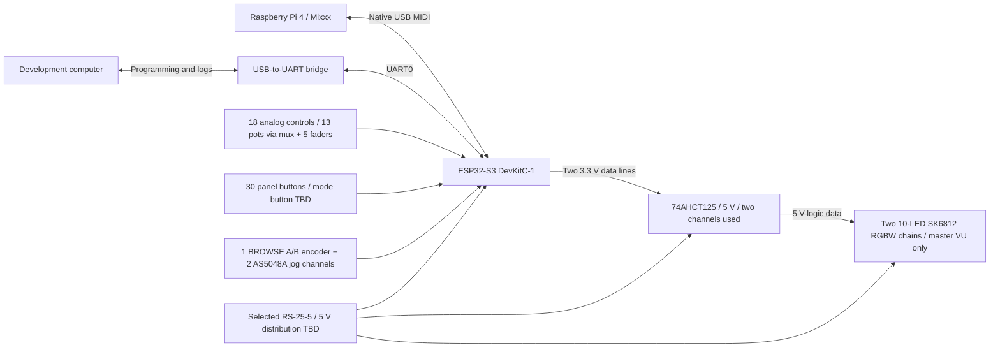

# beatbreaker — Product Design

This is the single current product specification, not a session log or work queue. [TODO.md](TODO.md) owns outstanding work; the [artifact register](docs/ARTIFACTS.md) identifies current/historical files; the [approval log](docs/APPROVALS.md) records engineering authority and scope. [Original documents](docs/history/pre-consolidation/README.md) are preserved as history.

## 1. Product and scope

A custom two-deck DJ/MIDI controller. An ESP32-S3-DevKitC-1 reads physical controls and drives LED indicators. A Raspberry Pi 4 runs Mixxx and acts as the USB host; the ESP32 is a USB MIDI device. The development computer uses the separate USB-to-UART port for programming and logs.

| Item | Current design decision | Qualification |
|---|---|---|
| Enclosure and panel | REV_A release: B26-CONSOLIDATED-02 drawing and B26-build123d03 model | Approved for an unpowered mechanical trial only; actual fit, strength, electrical and thermal safety remain open |
| Internal equipment | Raspberry Pi 4, Raspberry Pi DAC Pro, Mean Well RS-25-5 and controller boards | Display identity, actual interfaces, safe power distribution and complete power budget remain TBD |
| Jog mechanisms | Two non-pressing B26 jogs with AS5048A sensors | Physical fit, rotation and sensing remain unverified; mode-control button location and behavior are TBD |
| Construction | FDM/FFF enclosure parts in PETG | Jog and cap materials, orientations, supports and fit calibration remain TBD |
| Workshop | Bambu Lab P2S, 0.4 mm nozzle; engineer reports full 256 × 256 mm XY bed and an existing PETG setup | The project retains its conservative 250 × 250 × 250 mm part-screen limit. Actual PETG settings, supports/brim/raft, individual orientations and fit calibration are not recorded; 0.20 mm was selected for the mounting study, not every part |
| Electronics development | Breadboard, then integrated point-to-point wiring, then PCB | No production PCB or frozen GPIO map yet |
| Explicitly deferred | Behringer U-PHONO UFO202 until version 2.0; Wi-Fi/BLE outside current implementation | No current UFO202 mount or reserved geometry; it is a USB audio interface, not a power supply |

Use the distinctions **confirmed selection**, **provisional design**, **engineer-authorized assumption** and **TBD**. A selected item is not automatically hardware-verified; an approved drawing/model is not physical or manufacturing approval.

The sole current release is REV_A: its [trial handoff](models/release/enclosure/REV_A/REV_A_handoff.md) provides the approved B26 source, STL/STEP exports and verification limits; its [consolidated drawing and data](schematics/release/enclosure/REV_A/) use the same geometry. Earlier release packages, B24 Fusion and F.11/F12 jog revisions are historical, scoped references; their approvals do not extend to later geometry. A [pre-condensation snapshot](docs/history/DESIGN-before-condensation.md) retains the earlier detailed record locally.

### Selected enclosure palette B24-COLOR-C03

On 2026-10-22 the engineer explicitly selects **Pine Cherry**, the Pine Retro variant with red accents. [Selected illustrative concept](schematics/work/enclosure/B24-COLOR-C03/DJC_Enclosure_B24_COLOR_C03_07_pine-cherry_concept.png); [recorded color-only approval](docs/APPROVALS.md#engineer-selection-of-b24-color-c03-pine-cherry).

| Printed exterior part group | Selected color |
|---|---|
| Top-panel segments | Dark beige |
| Lower enclosure shell and raised display housing | Pine green |
| HOT CUE, CUE, PLAY/PAUSE caps and all five fader caps | Red |
| Rotary knobs and remaining small button caps | Dark brown |

Each printed part is single-color. Scope is the represented enclosure/control surfaces only; jog platters absent from the concept and internal parts have no new color assignment. Filament shade/finish is not physically verified. This selection changes no geometry, material type, print process or existing model approval; it does not authorize cloud saving or overwriting approved artifacts. The PNG remains an LLM concept, not a Fusion validation view.

Earlier illustrative B24 appearance studies are historical, not dimensional evidence. See the [artifact register](docs/ARTIFACTS.md) for their revision scope.

## 2. Functional architecture

This is a functional controller diagram, not an approved mains/USB wiring schematic or the complete Pi/display/DAC power tree. RS-25-5 is selected, but its full-system power adequacy, safe installation, distribution and USB paths still require verification.

## 3. Controls and supplied mechanical inputs

Counts refer to the complete controller, not one deck. Panel position IDs and jog part IDs are separate namespaces. The retained 30 panel controls are corroborated by the [REV_A STL manifest](models/release/enclosure/REV_A/STL/B26-build123d03_STL_manifest.json); the requested additional mode button is not yet integrated.

| Control / indicator | Quantity | Confirmed definition and source | Remaining interface limits |
|---|---:|---|---|
| Panel buttons B01–B24 / T01–T06 | 30 | 24 B buttons + 6 triangular T buttons. Supplied [B3F family drawing](elements/przycisk.png) and retained cap stem/socket interface. Current BOM: 12 small CAP_B + 6 CAP_T + 2 CUE + 2 PLAY/PAUSE + 8 HOT CUE caps; approved K03/B17 head details govern, not the old universal 14 × 14 head reference | Engineer reports good B18 button-seat fit for the tested hardware. Exact electrical variant, complete B24 installed stroke/return and neighboring-body clearance remain unverified; the source 1.8 mm callout is not established switch travel |
| Faders F01–F05 | 5 | Two tempo F01/F02 + two volume F03/F04, each with 41 mm travel; one crossfader F05 with 28 mm travel. Body 60 × 9 × 6 mm excluding terminals; blade 4 × 1 mm; exposed lever 15 mm; no mounting holes. [Image](elements/fader.png), [tempo cap](old_case/tempo-fader.stl), [cross cap](old_case/crossfader.stl). Current BOM: 4 CAP_F + 1 CAP_C | Retain approved end cups/central supports and engineer-reported good B18 mounting fit. Electrical variant, pinout, actual cap grip and complete terminal/solder clearance remain unverified; do not reinterpret conservative body-box overlaps as proof of an actual collision |
| BROWSE encoder E01 | 1 | Incremental A/B rotation only; the selected encoder's push contact is unused and left unconnected. [Drawing](elements/encoder_browse.png), confirmed A = 7 mm / L = 15 mm, M7 × 0.75 bushing and nominal Ø6 D-shaft. Current BOM: 1 CAP_E | Approved nominal cage/retainer/knob geometry is retained; actual mating, rotary terminals and final A/B GPIO allocation remain unverified. No press input or MIDI push action |
| Jog wheels / encoder channels JA/JB | 2 | One non-pressing B26 jog and one selected AS5048A magnetic rotary channel per deck, each with a Ø8 × 4 mm N35/Ni diametric magnet | Actual bearing, magnet/sensor clearance, rotation and sensing remain unverified |
| Potentiometers P01–P13 | 13 | 10 kΩ, stated shaft length 23 mm; [part drawing](elements/knob_potencjometr.png), actual [knob](old_case/knob.stl), native [legacy case](old_case/case.FCStd). Current BOM: 13 CAP_P | Retain cradle mounting and engineer-reported good B18 seat fit, not an assumed threaded clamp. Electrical taper and precise shaft datum remain TBD; do not subtract knob depth from shaft length without matching datums |
| Master VU LEDs MAIN_L / MAIN_R | 20 (2 × 10) | Two 10-LED SK6812 RGBW chains: MAIN_L = L01–L10, MAIN_R = L11–L20. Master stereo VU only; [electrical baseline](#6-led-subsystem) | Existing panel apertures retained; strip/diffuser mechanics, optical performance, electrical/current limits and the complete power budget remain unqualified. No deck-VU chains |

The B26 jogs do not have press switches. A separate NUDGE/SCRATCH button is requested; its location, behavior, component and input allocation are **TBD**. BROWSE push is excluded: leave its switch contacts unconnected and define no press action. See [JOG-MODE-01](TODO.md).

**Electrical demand:** 13 potentiometers + 5 faders = **18 analog controls**; **30 existing panel buttons**, plus the requested mode button when specified; **3 rotary channels** = 1 BROWSE + 2 jogs; **20 addressable LEDs on 2 data outputs**. Two PCF8575s are selected, but final input counts, per-port allocation, power paths and electrical verification remain TBD. The earlier E01 assignments require reconciliation before wiring.

### Retained cap and cradle geometry

- Potentiometer cradle: central 10 × 12 mm support with four L-shaped corners defining a 10.4 × 12.4 mm opening. The selected knob has nominal Ø6.10 circular/D socket and blind ceiling Z17; its socket does not establish actual shaft dimensions or calibrated clearance.
- Fader cups: nominal 9 mm transverse gap and 60.5 mm longitudinal span in the native tempo seats; central supports 9 × 30 mm or 30 × 9 mm. Reuse the mounting approach, not historical B02's incorrect 9 × 80 × 13 / 60 mm-travel fader assumptions.
- Performance cap: widest head 14 × 14 mm with R3 corners, stem 6.8 × 6.8 mm/R1, main socket 4.4 × 4.4 mm/R1, source engagement depth 4.6 mm. These are source readings, not proof of fit on actual B3F hardware. Several retained R06 circular holes cannot be assumed to pass the complete cap head; head-above/stem-through assembly and Z travel remain to be validated.
- Legacy STL is unitless. Native FreeCAD mm geometry corroborates the panel scale, but does not independently certify every cap's scale or physical fit. `tempo-fader.stl` has recorded duplicate/nonmanifold shoulder facets; it is a reference to reconstruct/repair before manufacture, not a certified printable mesh.

Detailed measurements, datums and mesh limits are in the [legacy source record](docs/APPROVALS.md#legacy-control-references-and-confirmed-variants-2026-10-14) and [native-seat update](docs/APPROVALS.md#confirmed-fader-data-native-seats-and-jog-trial-components-2026-10-14). Do not infer additional dimensions from pixels, meshes of neighboring parts or unmatched datums.

## 4. Mechanical assembly

### Current authorities

| Scope | Authority and limits |
|---|---|
| Enclosure and non-pressing jogs | [REV_A consolidated drawing/data](schematics/release/enclosure/REV_A/) and [trial handoff](models/release/enclosure/REV_A/REV_A_handoff.md); unpowered mechanical trial only |
| Earlier revisions | [Artifact register](docs/ARTIFACTS.md) and [approval log](docs/APPROVALS.md); revision-specific approval remains limited to its recorded scope |

The strict STEP volume comparison failed for both P01 rotors by about 0.6410915 mm³ each; C03/C05 reconstruction reverse Boolean results are invalid. Only specifically bounded unpowered-trial exceptions were accepted; neither is a strict pass. The release does not approve physical fit, strength, electrical/thermal safety or manufacture.

### Enclosure CAD workflow

The REV_A trial uses build123d and the packaged [source](models/release/enclosure/REV_A/SOURCE/); inspect its environment and dependencies before execution. B16–B24 Fusion and older OpenSCAD work remain historical sources. Preserve approved snapshots and obtain named drawing and model approvals for geometry changes.

### B17 minimum T-cap head draft

B17-TCAP-01 and B17-Fusion-01 were approved in their named nominal scopes; see the [drawing decision](docs/APPROVALS.md#engineer-approval-of-b17-tcap-01-minimum-head-drawing) and [model decision](docs/APPROVALS.md#engineer-approval-of-b17-fusion-01-minimum-head-model-for-export). Physical fit remains unverified.

### B18 triangular apertures and exterior panel details

B18-DETAIL-01 and B18-Fusion-01 were approved in their named nominal scopes; [drawing](docs/APPROVALS.md#engineer-approval-of-b18-detail-01), [model](docs/APPROVALS.md#engineer-approval-of-b18-fusion-01-for-export). This is not physical or complete-enclosure approval.

### B19 requested fader and jog panel recesses

B19-RECESS-01 and B19-Fusion-01 were approved with a scoped STEP representation acceptance; [drawing](docs/APPROVALS.md#engineer-approval-of-b19-recess-01), [model](docs/APPROVALS.md#engineer-approval-of-b19-fusion-01-for-export), [STEP exception](docs/APPROVALS.md#engineer-acceptance-of-step-rep-b19-01). The residual panel stock is not a strength pass.

### Requested low-profile enclosure and separated Pi/DAC

The B22 nominal drawing was approved; B22-Fusion-01 was not approved. Its separated-board study and the later B24/B26 packages have distinct scopes. See the [B22 drawing decision](docs/APPROVALS.md#engineer-approval-of-b22-layout-01-nominal-mechanical-prototype-drawing).

### B22 rear-packed electronics and continuous display roof

The [B22 drawing package](schematics/work/enclosure/B22/) is historical; its nominal approval does not establish actual purchased-part fit, service access or thermal/electrical safety.

### B24 left encoder group and reported B18 mounting fit

The engineer reported good button/fader/pot seat fit on tested B18 parts; exact printed IDs, setup and strength were not supplied. The B24 layout/model have separate [scoped approvals](docs/APPROVALS.md#engineer-approval-of-b24-fusion-01-and-requested-stl-step-and-f3d); do not extrapolate that physical observation to the complete B26 assembly.

### Requested B23 control, connector and flush-screw corrections

B23 is an unapproved historical proposal superseded by B24; see its [drawing package](schematics/work/enclosure/B23/).

### B21 flat body and raised display layout

B21 is an unapproved historical proposal superseded by B22; see its [drawing package](schematics/work/enclosure/B21/).

### B20 under-display packaging and right-rear connections

B20 is a superseded layout study, not a model or fabrication approval; see its [drawing package](schematics/work/enclosure/B20/).

### Low-profile jog F12 conditional concept

F12-D03 is an earlier pressable jog study: its nominal drawing was approved, but the D03 model was not approved. It does not define the non-pressing B26 jog. See the [drawing decision](docs/APPROVALS.md#engineer-approval-of-f12-d03-nominal-printed-prototype-drawing).

### F12-D04 localized PCB nut-loading access

F12-D04 drawing and model have separate nominal approvals and a bounded bearing-reference exception, not physical qualification. [Drawing](docs/APPROVALS.md#engineer-approval-of-f12-d04-nominal-printed-prototype-drawing) · [model](docs/APPROVALS.md#engineer-approval-of-f12-d04-fusion01-nominal-prototype-model) · [reference exception](docs/APPROVALS.md#engineer-accepts-the-scoped-skf-reference-exception-for-prototype-exports).

### F12-D05 localized P06 relief correction

F12-D05 drawing and model were approved, and its separate ten-file STL set was delivered. Final STEP/F3D and physical gates for that standalone scope remain open; the earlier D04 STEP P04 discrepancy was not accepted. See [approval](docs/APPROVALS.md#engineer-approval-of-f12-d05-fusion01-nominal-prototype-model-and-stl-request), [handoff](models/work/jog-wheel/F12-D05/Jog_Wheel_Rev_F12_D05_Fusion01_STL_handoff.md) and [TODO](TODO.md).

### Jog construction and approved interfaces

B26 has two non-pressing jogs; their printed-part quantities and source are in the [REV_A trial handoff](models/release/enclosure/REV_A/REV_A_handoff.md). The assembly uses incomplete bearing and sensor reference geometry, not fully modeled bought components. Actual bearing identification, fit, rotation, threads, sensor clearance and assembly remain unverified. Earlier F.11/F12 dimensions, movable carriers and springs are not the B26 assembly specification.

### Sensor, spring and validation limits

- The selected [AS5048A module](https://www.fruugo.pl/2x-as5048a-enkoder-magnetyczny-interfejs-pwmspi-wysokiej-precyzji-14-bitowy-silnik-bezszczotkowy-enkoder-as5048a/p-532477684-1079695071) has a supplied [15 × 17 mm drawing](elements/AS5048A_Fruugo_2626346230_dimensions.jpg), two Ø2.2 holes on 12 mm pitch and confirmed 2 mm bare laminate. Actual component height, contact and breakout implementation remain unverified.
- The selected magnet is Ø8 × 4 mm N35/Ni diametric. Verify actual magnet/sensor operation and clearance; the retained 100 × 100 [pinout image](elements/AS5048A_pinouts.jpg) is not sufficient to wire the breakout safely.
- In the earlier F.11 pressable mechanism, a PLA Rev A spring broke; the engineer later accepted Rev A PETG durability for tests only and required a metal spring for that older design. Measured lifetime and final component are not established. [Recorded decisions](docs/APPROVALS.md#rev-a-petg-accepted-for-tests-and-final-metal-spring-required); this spring is not a B26 jog requirement.

### Enclosure boundary

Supports, pilots/threads, fasteners, solder/wires and routing require actual-part and service checks. The B26 trial has scoped drawings and a model, but complete installed fit, tool access and assembly order remain unverified. Do not assume the complete jog can be inserted through a panel opening.

Split only printed bodies after checking complete installed component, fastener and joint envelopes. Preserve purchased parts. Bed size alone is not a valid seam-placement rule. R06 layout changes, final T apertures or other geometric corrections require their own drawing revision/approval; no silent changes to the accepted panel layout.

### MECH-02 lower-enclosure integration definition

**SOURCE-BACKED PREPARATION / CHANGES REQUIRED:** installed equipment and several installation choices remain TBD. The B15 working-model exception and older F.11 spring decisions are historical; the trial and its limits are defined above and in the [REV_A handoff](models/release/enclosure/REV_A/REV_A_handoff.md). Do not invent missing purchased geometry.

The R12–B25 sections below retain earlier interface measurements and revision-specific records. References to their then-current geometry, jog mechanism, next steps and CAD session states are historical; REV_A and later decisions take precedence. Confirm actual interfaces rather than transferring old clearances to B26.

#### R12 corner headphone jack and retained alignment

The engineer requested the supplied panel-mounted3.5 mm headphone jack in the left/rear corner above Pi, equally offset from both outer edges and clear of the retained screw; Pi may move toward+tableY. Current [two-sheet A3 R12 PDF](schematics/work/frontpanel/R12/DJC_frontpanel_R12_DRAFT.pdf), [complete CSV](schematics/work/frontpanel/R12/DJC_frontpanel_R12_DRAFT_coordinates.csv), [editable source](schematics/work/frontpanel/R12/DJC_frontpanel_R12_DRAFT.swift) and [evidence](schematics/work/frontpanel/R12/DJC_frontpanel_R12_validation.json) add only J01. **R12 layout is explicitly APPROVED; complete installed/manufacturing fit is not.** The [later acceptance](docs/APPROVALS.md#engineer-acceptance-of-r12-and-l09-b09-height-sections-authorized) supersedes historical pending labels without changing accepted files. All107 existing R11 records/header/CRLF bytes remain unchanged; J01 makes108 records. All predecessors remain preserved.

| IDs | Global X, mm | Retained global Y, mm |
|---|---|---|
| B01 / B02 / B03 | 105 / 125 / 145 | 22.25 |
| B04 / B05 | 125 / 145 | 46.25 |
| B06 / B07 / B08 | 485 / 505 / 525 | 22.25 |
| B09 / B10 | 505 / 525 | 46.25 |
| P01 / P02 / P03 | 455 | 21 / 49 / 77 |
| J01 headphone jack | 14 | 14 |

- **Retained right-edge derivation:** fullØ100 platters at JA X110/JB X490 have right edges X160/X540. For each paired B control, require `Xright−540 = Xleft−160`, hence Xright=Xleft+380 with identical Y. R10 introduced the+10 X shift from R09; R12 retains it without a new button move, reflection or pattern change.
- Outermost14 mm HEAD right edges are145+7=152 and525+7=532, both8 mm before their respective platter right edges. Retained15 mm aperture-edge offsets are7.5 mm. Column20/row24/lower-column2/3 pattern, head/profile dimensions and provisional statuses stay unchanged.
- **Centred IDs/colours:** retain all existing overview component centres and neutral B01–B10 colours. J01 is centred on its new axis; tiny LED-window/mounting-hole IDs stay unlabelled. Hn/Kn/JM mounting-axis callouts remain offset. Enlarged J01 plan and mounting section replace the obsolete historical button-move-focused detail; unchanged control dimensions remain available in preserved R11 and the complete schedule.
- No existing panel coordinate, profile, status, split, control, jog, display or screw axis changes. J01 is a separate headphone addition, not U01/Keple restoration. Preserve all35 screw axes and existing interfaces; no screen lift, enlargement, replacement USB opening or new support geometry.

##### J01 supplied geometry and mounting contract

| Definition | Source-backed value or explicit proposal | Limit |
|---|---|---|
| Selected input | [Supplied jack drawing](elements/pol_pl_Gniazdo-jack-sluchawkowe-3-5mm-przykrecane-pozlacane-PJ-392-x2-szt-20242_6.webp); filename PJ-392, title block PJD-035-77D | Supplied nominal geometry; actual-part/vendor identity and tolerances beyond explicit callouts remain unverified. One jack/nut is installed; the filename's two-piece pack is not a two-jack requirement |
| Axis / opening | Table(14,14), normal to rear upper panel; equal14 mm from outer left/rear edges. Nominal trial holeØ6.2 for M6×0.5 | Parent-selected0.2 mm diametral allowance; calibrate the actual printed hole/barrel before manufacture. No new anti-rotation feature or washer selected |
| Bare body / front nut | BodyØ8.0±0.15 → maximumØ8.15; nutØ8×1.8 | Use maximum bare-body projection for packing, not only theØ6.2 hole. Plug, solder, wire, tool and insertion/removal volumes are excluded |
| Axial chain | Thread reach4.5; body11.8 + terminals6.5; R12 rear-edge stack2/1.8 leaves nominal0.7 | B09 localizes the retained slope at upper-face(14,14,Z57.3): normal panel thickness1.997505, nominal remaining thread0.702495 and terminal-axis endZ37.027820. Z56/58 and end37.7 are rear-edge references, not the installedY14 values. No usable-engagement, tolerance, strength or wiring pass |
| Corner screw reserve | S1-M1 fixed(8,4), actual holeØ3.4 plus inherited proposedØ9 foot reference. J01 body/foot separation√136−4.075−4.5=3.086904 | Chosen3 mm planar reference reserve only. Equal13 mm offset leaves1.720630, so14 is the first integral-mm candidate under this constraint; actual head/tool/installed-post access is not certified |
| Pi separation | Pi moves+12 tableY; bare-reference rear edge21.5 minus J01 body front18.075 gives3.425 | An11 mm move gives2.425 and fails the chosen3 mm reference reserve. Full mounted DAC/RCA and connected stack remain unknown |
| Audio boundary | [IQaudio guide v32](elements/20201209%20IQaudIO_v32.pdf), p8, confirms a dedicated DAC Pro headphone amplifier/socket and P6 headphone signals | J01 is the intended external headphone interface. Actual wiring/connector choice, signal/detect mapping and operation remain electrical integration work; do not substitute RCA line outputs or invent a detect circuit/plug envelope |

#### Preliminary installation layout L09

Current [two-sheet A3 L09 PDF](schematics/work/enclosure/L09/DJC_Installation_Layout_L09_DRAFT.pdf), [editable source](schematics/work/enclosure/L09/DJC_Installation_Layout_L09_DRAFT.swift) and [evidence](schematics/work/enclosure/L09/DJC_Installation_Layout_L09_validation.json) consume R12's108-record schedule. **L09 planar placement is explicitly APPROVED**, with its original reference-envelope limitations; this is not a complete installed-fit or enclosure-model approval. [Later acceptance](docs/APPROVALS.md#engineer-acceptance-of-r12-and-l09-b09-height-sections-authorized) supersedes historical pending labels. J01 and the Pi/PCB/mounting pattern+12 tableY are retained; other equipment, controls, supports, jogs, dimensions and neutral colours stay fixed. All predecessors remain preserved.

- **Corrected jog representation:** dashed greyØ100 is the platter reference only. The solid dark external full-height housing projection unions theØ50 core, switch shelf(local X22…35.2/Y±7), three bridges(radial22…31/width10) andØ10 ear caps on PCD62. Native-validated local envelope67.046788 ×61 is retained; this is not a section or an assertion that the interior is free packing space. Whole-jog CAD-Z+60° applies to every feature, using the coordinate transform below.
- **Inherited jog floor interface:** six named JMA1…3/JMB1…3 axes match F.11 sheet09; dashed blueØ10 bosses sit coaxially beneath the ears, with solidØ2.9 ear holes and dottedØ2 trial pilots. Boss height6, ear thickness3, pilot depth5 and jog base globalZ8 are unchanged. Axis callouts are intentionally offset. No new supports, hole positions, physical geometry or model changes are selected.

- **Moved Pi reference:** bbox centre(47.6,50.7),CW0°,88.99 ×58.4, boundsX3.105…92.095/Y21.5…79.9. PCB centre(45.605,49.5),85 ×56; four axes(6.605,25),(6.605,74),(64.605,25),(64.605,74), unchanged58 ×49 pitch. Existing36-above/4-below stack inputs are unchanged; no extra spacer/cooler or Fusion transform is applied.
- **Retained PSU/jogs/supports:** PSU combined92 ×51 centre(569.75,58),CW90°, case centre(569.75,65), terminals rear−Y; F.11 whole-jog pose/geometry and all35 actualØ3.4 holes/proposedØ9 post-foot references unchanged. The [B02 source](models/work/enclosure/B02/source-package/DJC_spod_B02/build_body_B02.py), line215, supplies only R4/R4.5 footprint provenance, not old heights or installed support acceptance.
- **Current corner constraint:** J01(14,14) uses maximumØ8.15 bare-body packing and the chosen3 mm study reserve. Body/S1-M1 proposed-foot gap3.086904, body/Pi gap3.425; Pi/B01 gap remains5.405 and panel-left margin3.105. PSU/post minimum3.5 and PSU/B08 gap11.75 remain unchanged. The old L05–L08 fixed-X1 mm rearward-Pi optimum is superseded by the new jack constraint, not an additional current placement rule.
- **Verified coverage:**156 references(121 base including J01+35 proposed supports),312 equipment/reference pairs(242 base+70 support)+1 mutual, J01 versus all155 retained references and32 Pi/PSU-to-jog-part pairs all have positive separation. Independent signed polygon/circle calculations confirm recorded results and panel containment. FullØ100 platter checks and solid physical jog projections remain distinct; this does not certify complete plugged/tool/wire geometry.
- **Missing installed scope remains:** full mounted DAC/RCA XY relative to Pi PCB, plugged display, final supports/heads/tools/threads/walls/guards/service and thermal/electrical/physical acceptance. The [manufacturer brief](https://datasheets.raspberrypi.com/audio/dac-pro-hat-product-brief.pdf) does not dimension complete RCA overhang. Existing36 mm above PCB underside, M2.5×10+6 and4 mm exposed thread stay closed inputs.

Executed native generation/PDFKit reopen/render and final visual review of all four2381 ×1684 sheets. Independent checks passed107 exact retained records plus singletonJ01, equal-edge/screw and12/11 Pi-shift boundary arithmetic, complete312+1/155/32 separations, translated Pi/PCB/mounting axes and preserved source/history hashes. Direct PDFKit measurements passed113 component-label centres(max0.128684 mm against0.5 mm presentation threshold); final raster checks passed14 jack/Pi/axial-boundary probes and20 neutral button regions. Corrected one overlapping plan dimension label before regenerating/reviewing final R12. No Fusion/BRep, model export, physical thread/fit/strength or thermal/electrical pass; complete drawing/concept and named approval gates remain.

#### B09 height sections and lower mounts

The engineer explicitly accepts R12/L09 and the subsequent B09 section/local-mount drawing. [B09 section PDF](schematics/work/enclosure/B09/DJC_Enclosure_Rev_B09_sections_DRAFT.pdf) contains14 searchable A3 sheets; [editable Swift generator](schematics/work/enclosure/B09/DJC_Enclosure_Rev_B09_sections_DRAFT.swift), [equipment definitions](schematics/work/enclosure/B09/DJC_Enclosure_Rev_B09_equipment.json), [control definitions](schematics/work/enclosure/B09/DJC_Enclosure_Rev_B09_controls.json), [sensor definitions](schematics/work/enclosure/B09/DJC_Enclosure_Rev_B09_sensors.json) and [validation](schematics/work/enclosure/B09/DJC_Enclosure_Rev_B09_validation.json) form the six-file package. **B09 is APPROVED within its nominal section/local-mount scope, not complete-shell, model or manufacturing approval.** [Later named acceptance](docs/APPROVALS.md#engineer-acceptance-of-b09-section-and-local-mount-drawing) supersedes its historical pending labels; preserve all six files and earlier engineering inputs unchanged.

| Interface | New B09 nominal definition | Boundary |
|---|---|---|
| Height datums / panel posts | FloorZ0…2; panel underside `50+max(0,120−Y)*0.05`, upper+2.35 retained axes, verticalØ8 cores, perimeter-clippedØ9 feet; top follows slope; normal-axisØ2.5×10 trial pilots, nominal M3×8 | Z56/58 are rear-edge values only; no flat rear-plane shortcut. Actual printed threads, head tolerance and strength unverified |
| Pi/DAC | FourØ7 pads, top/PCB undersideZ8; Ø2×5 trial pilots endZ3; existing4 mm studs endZ4. DAC maximumZ44; bare-Pi lower referenceZ5.9 | Nominal pilot reserve1, bare-Pi/floor gap3.9, minimum panel-height gap8.005 over bare XY only. No extra lower spacers/cooler or complete DAC/RCA fit claim |
| PSU | Retained bottom55 pitch; twoØ10 pads atZ2…8.2; Ø3.4 clearance and undersideØ6.4×3.2 recess; M3×8 from below | Nominal head bottomZ0.2, caseZ8.2…36.2, penetration3 versus sourceL4, reserve1. Actual thread/head fit and mains installation remain separate |
| B/T switches | 30 fixed floor cups and removable housing retainers; seat `S=f−7.2`; free head shoulder `U+1.5`; conditional cap insertion1.2, not socket depth4.6 | Body captured without selecting physical switch stroke/preload. Measured press/return, source corners and cap grip remain required |
| T heads / passage | Accepted B09 triangular head18.2×4, retained stem/socket; direction−X for odd T /+X for even;8×8 R1.4 stem passage at unchanged axes | R12's10×10 triangles remain immutable REFERENCE symbols. Carry the accepted B09 detail into the complete panel drawing. Head covers the rounded aperture by minimum0.537926 nominal; actual mating/press/return remain unverified |
| Potentiometers | 13 fixed floor-connected corner cradles and removable retainers; source-view unionX±5.7/Y−5.5…7; pocketX±5.9/Y−5.7…7.2; seat `S=U−12.7` from source rear-to-tip30 | Reuse native mounting principle, not undersized centered10.4×12.4 pocket. No side adjustment/towers or26 additional side screws. Confirm real bearing/collar/shaft/terminal mating; do not re-ask known shaft23 |
| Faders / BROWSE | Five end-cup/rail seatsZ41.3 or40.8, removable bridges and source cap engagement; E01 seat41.25, fixed-housing cage and shallow D-socket knob | Full41/28 fader slide and0…0.6 encoder source envelope checked; actual contacts, cap grip and terminal profiles remain unverified. Source tempo mesh defect is not silently repaired |
| AS5048A / switches | Frozen B09 defines seatsZ15.5, conditional toes and local180/totalCAD240 clocking; four relieved switch saddles7 thick with M2×20/plane washers/nuts | Confirmed laminate2 exceeds B09'st≤1.7 study condition. B10 now supplies a complete numeric sensor correction; B09 bytes and switch definitions remain unchanged. Actual module/printed fit is not thereby passed |
| Display / unidentified electronics | B09 intrusion was only a datum study. Engineer now explicitly selects rear insertion and confirms A2/B17 from the front surface bearing on the panel underside | B10 supplies numeric rear-frame retention. Full rear-body/plug/service fit, DAC/RCA and actual DevKit/PCF/mux/buffer implementations remain required for complete installed release |

Verification executed: native Swift/PDFKit generation/reopen/render; all14 sheet contents reviewed with corrected sheets re-inspected. Separate consumer calculations checked49 control height/axis chains,35 inclined/flat panel posts, eight sensor axes and six retained jog-floor axes.809 conservative additive primitives/100 support owners have no cross-owner intersection across322239 pairs;124 verticalØ4 driver reserves clear98504 cross-owner support-reference pairs.4013 new-primitive/equipment/jog-reference pairs and65930 cap/source-motion-to-support/cap pairs pass in the explicitly represented scope. Own mount contacts/cavity features are excluded deliberately; cuts can only reduce these conservative outer bounds. B/T motion remains free-state only, faders use full41/28 source travel and encoder0…0.6. Actual final-PDF checks cover49 rows/245 numeric cells and21 geometric features with19 outline probes plus four material/void samples. These numerical/presentation checks are not manufacturing tolerances, complete BRep/installed geometry or physical tests.

The accepted [B10 detail drawing](#b10-display-and-sensor-mounting-details) closes the nominal display/sensor drawing work without rewriting B09. Remaining complete-installation prerequisites: real display/frame/plug/service fit; sensor height/contact/calibration and printed retention; real control mating, terminals, stroke/return and grip; full mounted DAC/RCA/controller-board implementations; connected/service geometry; complete walls/joints/print splits, optics and rear ventilation/mains guarding. Do not re-ask closed A/B, seating direction, sensor laminate thickness or a sensor photograph. No Fusion, save/export, physical/electrical/thermal or complete-shell acceptance follows.

#### B10 display and sensor mounting details

[B10 drawing](schematics/work/enclosure/B10/DJC_Enclosure_Rev_B10_mounts_DRAFT.pdf), six searchable A3 sheets; [editable Swift](schematics/work/enclosure/B10/DJC_Enclosure_Rev_B10_mounts_DRAFT.swift), [display definition](schematics/work/enclosure/B10/DJC_Enclosure_Rev_B10_display.json), [sensor definition](schematics/work/enclosure/B10/DJC_Enclosure_Rev_B10_sensors.json) and [executed evidence](schematics/work/enclosure/B10/DJC_Enclosure_Rev_B10_validation.json) form the five-file accepted package. **[Named engineer acceptance](docs/APPROVALS.md#engineer-acceptance-of-b10-display-and-sensor-mounting-details) covers the nominal local mounting details only.** Freeze all five files, including historical DRAFT/pending labels. This is not complete-shell/CAD/manufacturing release. [Authority and reconciled rear-insert datum](docs/APPROVALS.md#b10-rear-insert-display-seating-and-depth-explicitly-selected).

| Interface | B10 nominal definition | Verification boundary |
|---|---|---|
| Display front capture | Rear insertion: front surface bears on panel UNDERSIDE, centre(300,46.25,53.6875), inward normal depth17. R12 opening272×72 and XY remain unchanged | Supersedes the earlier top-insert illustration, not accepted files. No guessed front-keeper height, front fingers or adhesive |
| Rear frame retention | Four1×8 bearing pads at localu±137/v±24/w−17; separate9×8×3 toes with1-high pads; four integral7×12 columns and local side/end guides | Right A2/B17 is measured; left mirrored contact placement is selected, requiring real band/coplanarity/guide engagement and toe-sweep checks |
| Display fastening/service | Four reverse M3×8, nominal5 useful engagement/2 blind reserve/2 roof; two1.9-wide continuous rails per column; four normalØ8 galleries through new floor and columns | Real Wera2.5×50 bit full-hex envelopeØ7.332348 fits nominally. Galleries give screw access, not closed-shell manual toe access; open shell/panel for9mm inward withdrawal |
| Sensor height | Confirmed laminate2; selected nominal projection1.10; seat/back14.40, laminate top16.40, IC face17.50. Source1.5 travel and clocking retained | Projection is a documented engineering selection from package dimensions, not measured actual soldered height or magnetic acceptance |
| Sensor support/clamp | Four integral supports, four capped0.8-thick toes and outboard M2×6 screws; toe16.4…17.2, full-press holder clearance1.3;5 engagement/2 tip reserve | No unnecessary locating-hole cut through the narrow toe; source peg ends1.6 below the cap. Nominal supported laminate overlap2.678673 per toe/back pad, not strength or insulation certification |

Executed: native Swift/PDFKit generation/reopen/render and all-six-sheet visual review;72 new conservative primitives against789 retained primitives,80736 counted reference/driver/cap/cross-owner pairs without unexplained represented intersection. Independent source/CSG checks cover rail paths, capture, pockets, threads, floor access, axes, source-unit conversion, toe connectivity and continuous radial/vertical mechanism bounds. Actual final PDF:27 text cells/72 numeric values and34 material/void probes. The retained modeled lower clamp reference was read from F.11 STEP centimetres and converted×10; full-press source bound remains7.8 above the toe. These are scoped numerical/presentation checks, not native BRep or actual compressed-spring/connected-body proof.

All216 engineering inputs, including the complete B09 package, match retained fingerprints;11 volatile Finder metadata records are excluded. Existing user `test.svg` is also unchanged. Review scaffolding/previews/vendor inspection copy were removed; no Fusion/model/save/export operation occurred. Actual height/lands, mirrored display contact, threads, rails/toes, material/orientation, optical damage and complete harness/service fit remain physical qualification gates.

#### B16 trial RCA passage correction

Preserved pre-Fusion working3D basis: [B16 SCAD](models/work/enclosure/B16/DJC_Enclosure_Rev_B16_DRAFT.scad), [actual passage detail](models/work/enclosure/B16/DJC_Enclosure_Rev_B16_RCA-detail_openscad-view.png), [local dimensioned PDF amendment](schematics/work/enclosure/B16/DJC_Enclosure_Rev_B16_RCA_DRAFT.pdf), [definition/derivation](schematics/work/enclosure/B16/DJC_Enclosure_Rev_B16_RCA_definition.json) and [validation/handoff](models/work/enclosure/B16/DJC_Enclosure_Rev_B16_validation.md). **Historical publication: DRAFT / CHANGES REQUIRED / NOT APPROVED.** The engineer reports that B15's screw holes alone cannot pass the RCA body and explicitly selects **“Dobierz próbne okno”**, authorizing Basia to choose the shared trial opening while retaining screw lands; this is not manufacturer cutout data or complete drawing/model approval.

- Only the printed C02 rear wall changes: through window34.9×15.9 centred table(265,0,18), X247.55..282.45/Z10.05..25.95/Y0..2. Width43.9−9 preserves selectedØ9 wall lands about both existing screw axes; height19.9−2×2 leaves2 top/bottom face cover. Hole-edge ligament2.7 and side face cover8.4 are geometric values, not strength/bearing acceptance. Source holesØ3.6 at(243.05,0,17.95)/(286.95,0,17.95) remain unchanged.
- Actual C02 Manifold mesh is closed/oriented/connected, nominal160×120×56, zero warnings; measured window extent34.9×15.9 and195 through-wall material/void probes passed. Removed volume1109.82mm³ matches retained B15 C02 difference. Five actual model PNGs and one native A3 PDF/10 searchable cells were reviewed. All258 prior engineering/input files, including B15 and approved packages, remain unchanged.
- Actual rear solder tabs/body passage and retention remain physically UNVERIFIED. All B15 display/inlet/controller/mux/print/strength/electrical/thermal limits remain; no fabrication exports. B16 reuses immutable B15 compiled dimensional data and referenced meshes; it does not regenerate B15 in place.

Current native CAD: **B16-Fusion-01**, [Fusion report](models/work/enclosure/B16/DJC_Enclosure_Rev_B16_Fusion01_validation.md), [assembly](models/work/enclosure/B16/DJC_Enclosure_Rev_B16_Fusion01_assembled_fusion-view.png) and [native evidence](models/work/enclosure/B16/DJC_Enclosure_Rev_B16_Fusion01_validation.json). B16 dimensions/positions remain the basis; native circles replace OpenSCAD's48-sided evaluation approximation, so analytic volumes are not byte/volume-identical meshes. No new nominal dimension or physical-fit approval follows. Original B16's separate review-STL acceptance does not approve Fusion01; its later [own nominal export approval](docs/APPROVALS.md#full-fusion-cutover-and-named-b16-fusion-01-approval-for-export) now governs the IN PROGRESS Fusion package.

#### Original B16 approved assembly-review STL

The engineer explicitly selects **“Zatwierdzam B16 do STL”** for the original nominal modeled printed assembly, excluding purchased/electronics/reference envelopes. [Named approval](docs/APPROVALS.md#named-b16-approval-for-one-printed-assembly-review-stl). Delivered [one ASCII STL](models/work/enclosure/B16/DJC_Enclosure_Rev_B16_assembly_review_mm.stl) and [export verification/scope](models/work/enclosure/B16/DJC_Enclosure_Rev_B16_assembly_review_export.md):600×300×76.75mm,2635544 triangles,770.9MiB, no geometry/pose/scale change. Native indexed surfaces are closed/oriented and the final file has no degenerate facets;2435 globally coordinate-coincident edge contacts remain in this multi-surface assembly, not a single welded manufacturing solid.

This approval/export applies to original B16/OpenSCAD only, **not B16-Fusion-01**, complete enclosure drawing/physical release or individual print files. All271 pre-existing engineering/input files are unchanged; historical DRAFT labels are preserved. No final-STL viewport pass is claimed after the cache-limited reimport attempt; full-precision/native-index file verification is recorded. The rejected binary trial was removed. Existing display/inlet/RCA/contact/print/strength/electrical/thermal limits remain.

#### B15 working OpenSCAD enclosure model

Preserved working-model basis: [B15 SCAD](models/work/enclosure/B15/DJC_Enclosure_Rev_B15_DRAFT.scad), [source manifest](models/work/enclosure/B15/DJC_Enclosure_Rev_B15_sources.json), [review report](models/work/enclosure/B15/DJC_Enclosure_Rev_B15_validation.md). **[B16](#b16-trial-rca-passage-correction) supersedes its missing RCA passage and review views only; all B15 files remain unchanged.** The following describes B15 publication scope. Its [explicit engineer exception](docs/APPROVALS.md#working-enclosure-3d-authorized-before-complete-drawing-approval--b15) permits working3D before complete drawing approval, not fabrication release.

- Native editable CSG combines B12 six floor/wall regions and ten bridges, B14's48 mirrored hex cuts/nominal inlet trial, B13 rear port positions, all35 B09 posts and69 exact fixed-mount groups. B09/B10 additions AND cuts are consumed directly, not replaced by conservative additive boxes.
- The61 removable source groups evaluate to66 separate surfaces:30 switch retainers,13 pot retainers,10 fader bridges, one encoder retainer, four display toes, four sensor toes and four switch saddles. Seven panel regions follow unchanged R12 split construction; T passages use the accepted B09 8×8/R1.4 detail, not CSV reference triangles. Retained caps/knobs and eight F.11 printed mesh definitions per jog are referenced unchanged; no jog remodeling.
- Reference-colored Pi/DAC, PSU, controller and rear-port boxes are explicitly incomplete packaging references. The display is represented by its known contact-datum outline, **not a guessed deepest rear-body solid**. Mux3.6 is body-only with pinsTBD. Unknown RCA body cut, new board contacts and inlet clip/corner/registration remain unresolved; only RCA source screw holes and the nominal47.5×28 inlet trial are cut.
- Views selectable in SCAD: assembly, open, rear, section, segments, floor, panel, bridge and retainers. `segment=0..5` selects an individual floor region; `-1` selects all. The source is editable now, but printed-thread/fit/strength and fabrication approval are not implied.

#### B14 selected inlet and twin rear grilles

Current amendment: [three-sheet B14 PDF](schematics/work/enclosure/B14/DJC_Enclosure_Rev_B14_rear_DRAFT.pdf), [illustrative PETG concept PNG](schematics/work/enclosure/B14/DJC_Enclosure_Rev_B14_concept.png), [definitions](schematics/work/enclosure/B14/DJC_Enclosure_Rev_B14_definition.json), [numerical audit](schematics/work/enclosure/B14/DJC_Enclosure_Rev_B14_checks.py), [native generator](schematics/work/enclosure/B14/DJC_Enclosure_Rev_B14_rear_DRAFT.swift) and [evidence](schematics/work/enclosure/B14/DJC_Enclosure_Rev_B14_validation.json). **CHANGES REQUIRED / NOT APPROVED** for complete installed/model-ready release. The engineer confirms the purchased-inlet drawing and requests the second matching grille; liking the grille is not named approval of B13/B14 or the whole enclosure.

- **Selected inlet source is now closed:** [gniazdo_zasilania_nowe.png](elements/gniazdo_zasilania_nowe.png) governs the purchased part. Nominal cutout47.5×28 with source+0.1 height annotation, face50×30.5, front flange3, sectional depth callouts30.5/29.4. Old image46.9..47.1/20.7/R2 remains history only; do not use it for current cutting/fit. No extra FDM allowance, numeric corner radius, clip/permitted-wall or registration dimension is invented.
- **Declared conservative depth interpretation:** flange seats at outerY0, front planeY−3; largest sectional30.5 gives rear proxyY27.5. From inner wallY2, inward proxy is25.5=`30.5−3−2`,1.5 beyond the former assumed24. This is a transparent selected-source interpretation, not a measured complete terminal solid. RCA24 and both rear face centres(265,0,18)/(335,0,18) stay unchanged. Revised mains/frame-contact-plane gap4.353763 is not actual display-body clearance.
- **Twin identical grilles:** V01 retained zoneX20..90/Z10..38 at the RPi end; V02 zoneX510..580/Z10..38 is its exact mirrorXnew=600−Xold. Retained RPi centreX47.6 and PSU centreX569.75 explain the equipment ends; concept/view handedness never moves them.24 hex cells each, across-flats6/web1.2/wall2/border≥3;48 total, nominal opening area1496.492mm². Both cuts remain in C01/C03 rear walls and clear represented support/join/port geometry; no bought component is cut or split.

Executed:1720 revised rear-port/reference comparisons;41376 grille-cut/reference pairs; exact mirror/containment, polygon non-overlap/minimum web1.2 and10.5 minimum planar X gap to rearØ9 foot references. Three native A3 sheets generated/reopened/rendered and visually reviewed;12 actual-PDF cells/8 rendered boundaries/three A3 draft gates passed. Concept generated from the revised draft/selected source, actually converted WebP→PNG1536×1024, reopened and reviewed. All241 prior engineering/input files, including complete B13/B12 and approved packages, remain unchanged. Task previews removed; no enclosure3D/model save/export or physical/thermal/electrical release.

The source-selection/Allegro-access blocker is **closed** by the engineer's identification; do not request another offer link or image confirmation. Actual display rear body, bought clip/contact/registration, mux pins and physical print/thread/thermal qualification retain their limits. The PSU-side opening is not terminal guarding/touch protection; engineer-owned electrical protection still requires its separate pre-energizing review.

#### B13 rear-interface amendment and latest engineer inputs

Supporting B13 rear package: [PDF](schematics/work/enclosure/B13/DJC_Enclosure_Rev_B13_rear_DRAFT.pdf), [publication-time concept](schematics/work/enclosure/B13/DJC_Enclosure_Rev_B13_concept.png), [definitions](schematics/work/enclosure/B13/DJC_Enclosure_Rev_B13_definition.json), [audit](schematics/work/enclosure/B13/DJC_Enclosure_Rev_B13_checks.py), [generator](schematics/work/enclosure/B13/DJC_Enclosure_Rev_B13_rear_DRAFT.swift) and [evidence](schematics/work/enclosure/B13/DJC_Enclosure_Rev_B13_validation.json). All six files remain unchanged. [B14](#b14-selected-inlet-and-twin-rear-grilles) supersedes its inlet-source uncertainty/depth proxy and single-grille concept; the following B13 values describe publication-time scope, not current inlet dimensions. No package has complete enclosure approval.

- **Latest engineer inputs:** enclosure material **PETG**; mux body41×18×3.6 **excludes installed pins**. Do not carry B12's conditionalZ8..11.6 forward as a complete mux fit. Engineer instructs using already supplied board schematics/dimensions; do not restart a supplier/photo inventory. Reuse the retained ESP reference, PCF32×21/laminate2/header8-above1-below and mux body data without deriving purchased holes/contact dimensions from pixels. Retained [PCF supplier source](https://sklep.msalamon.pl/produkt/pcf8575-ekspander-portow-i-o-16-kanalow/) is recorded in the preserved B02 README and confirms32×21; photos are identification/reference only.
- **Both interfaces now on rear wallY0..2:** RCA face centre(265,0,18), mains(335,0,18); inward24 from innerY2 givesY2..26. RCA X239.15..290.85/Z8.05..27.95; mains X310..360/Z2.75..33.25. Face gap19.15; nearest retained post-foot edge gaps4.65 and5.5 respectively. RCA source mounting axes(243.05,0,17.95)/(286.95,0,17.95), pitch43.9/Ø3.6; do not recenter its source9.9 row. No side openings, rear pods, outer-envelope expansion or accepted equipment moves.
- **Display limit:** both ports lie below the display plan. Minimum proxy gaps to the B10 frame-contact plane are9.728763 RCA and4.428763 mains; these are **not actual display-body clearances**. Keep confirmed17 frame datum unchanged; actual deepest driver/body interference remains unverified before complete release.
- **Inlet source conflict:** engineer's private My Allegro purchase-page link returnedHTTP403; no offer details, login/access bypass or variant identity verified. Private transaction path is not copied into public design artifacts. The existing [newer inlet image](elements/gniazdo_zasilania_nowe.png) labels cutout47.5×28(+0.1), conflicting with the originally selected image's46.9..47.1 width. Its applicability to the selected offer is unconfirmed; no silent substitution or cutting release. Sectional3/29.4/30.5 labels are not equated with the closed24 inward datum.

Executed: inherited B12 source audit plus two rear packing proxies against806 retained bounds,50 joining/driver bounds and4 full-height controller-plan reserves:1720 non-overlap comparisons. This neither supplies mux pin height nor certifies all purchased bodies. Three native A3 sheets generated/reopened/rendered and visually reviewed;11 actual-PDF cells/8 rendered boundaries/three A3 draft gates passed. Illustrative image corrected for inlet proportions/invented face screws, actually converted WebP→PNG1536×1024, reopened and reviewed. All235 earlier engineering/input files, including B12 and both inlet images, remain unchanged. Task preview directory removed; no enclosure3D/model save/export or physical/electrical/thermal release.

#### B12 shell and installation definition draft

Supporting B12 shell/joining package: [seven-sheet A3 drawing](schematics/work/enclosure/B12/DJC_Enclosure_Rev_B12_drawing_DRAFT.pdf), [publication-time concept](schematics/work/enclosure/B12/DJC_Enclosure_Rev_B12_concept.png), [definitions](schematics/work/enclosure/B12/DJC_Enclosure_Rev_B12_definition.json), [audit](schematics/work/enclosure/B12/DJC_Enclosure_Rev_B12_checks.py), [generator](schematics/work/enclosure/B12/DJC_Enclosure_Rev_B12_drawing_DRAFT.swift) and [evidence](schematics/work/enclosure/B12/DJC_Enclosure_Rev_B12_validation.json). All six files remain unchanged. **[B13](#b13-rear-interface-amendment-and-latest-engineer-inputs) supersedes its side-interface poses/concept and material/mux interpretation only.** Both packages remain NOT APPROVED, not complete model-ready release.

- **Delegated shell choices:**2mm walls inside retained600×300 floor, same underside-following top edge and35 existing post/screw closure. Six integral floor/wall regions at X220/380 and Y120 retain2mm floor and all accepted sources. These seams are midpoints between nearest retained post-foot edges, not merely a grid selected to fit the printer;432 represented floor additions and whole support-owner containment were checked.
- **Joining:**ten identical separate C07 bridges28×10×3, twoØ3.4 holes on18 pitch, two integralØ9 pads/topZ8 per joint, trialØ2.5×5.5 pilots and twenty nominalM3×8 screws. BridgeZ8..11/head max14, nominal engagement5/tip reserve0.5. Vertical joining precedes equipment installation; six regions form a connected graph. Printed thread/strength and seam-fit coupons remain physical prerequisites.
- **Retained controller poses:** ESP(300,225), PCF1(181,165), PCF2(181,195), mux(410,180), CW0. ESP/PCF undersideZ8 gives confirmedZ7..18. B12's conditional muxZ8..11.6 is not a complete installed envelope: the engineer subsequently confirms3.6 excludes pins. Use supplied schematics/dimensions for mounting proposals, without inventing holes or scaling contacts from photographs.
- **SUPERSEDED side-interface proposal:** B12 left RCA/right mains atY163/Z25 is preserved as history only. Current B13 puts both interfaces on the rear atX265/335,Z18; use its poses, source offsets and explicit display/inlet limits.
- **Passive grille:** rear-left integral honeycomb, zoneX20..90/Z10..38,24 hex holes/across-flats6/web1.2/wall2/border≥3; nominal opening area748.246mm². No fan, mains guard, effective-airflow or thermal pass.

Executed:806 conservative retained additive/reference AABBs versus50 new bridge/pad/driver bounds in40300 comparisons; cross-owner new-feature non-overlap;8060 additional full vertical bridge insertion/reference pairs; seam/support ownership and connectivity; nominal segment envelopes≤220×180×56. Native PDF generation/reopen/render and all-seven-sheet visual review,12 actual-PDF numeric cells/11 rendered boundaries/seven A3 sizes passed. All229 prior engineering/input files and five approved B10 hashes remained unchanged. Concept generated, corrected, actually converted from WebP to PNG, reopened and reviewed; task-only vendor/PDF previews removed. Usable bed margins/brim/support/material/setup, actual purchased contacts and full physical/electrical/thermal fit remain unverified. At B12 publication, complete drawing approval preceded enclosure OpenSCAD3D; the later B15 sequence exception and current Fusion-native contract supersede that historical workflow, not its physical limits.

#### B11 interface and review-zone study

[B11 three-sheet A3 PDF](schematics/work/enclosure/B11/DJC_Enclosure_Rev_B11_interfaces_DRAFT.pdf), [editable native generator](schematics/work/enclosure/B11/DJC_Enclosure_Rev_B11_interfaces_DRAFT.swift), [source/interface definitions](schematics/work/enclosure/B11/DJC_Enclosure_Rev_B11_interfaces.json) and [executed evidence](schematics/work/enclosure/B11/DJC_Enclosure_Rev_B11_validation.json) form a bounded **MECH-02 interface study / CHANGES REQUIRED / NOT APPROVED**. This is not the complete MECH-03 enclosure drawing, a selected new layout, a 3D model or a fabrication release.

The study retains L09/B09 plan references and B10 gallery/contact datums, shows four unplaced controller-plan outlines and the sourced RCA/inlet planar interfaces, and explicitly separates known dimensions from TBD body/mounting data. Proposed review zones only: RCA at the rear/left near Pi/DAC, mains entry rear/right near PSU, controllers beneath the display. No new assembly X/Y/Z is selected; numerical paper locations and local component datums are not assembly placements.

Source-derived constraints: selected RCA face/mount holes do not define socket openings or full axial body/terminal depth. Inlet20.7 excludes projecting terminals and is not complete installed reach. Retained PSU case starts at tableY26 while the L09 terminal PLAN reference starts atY12; this is not a solid intersection/clearance test. B10 rear-frame contact at normal17 from the underside is not the lowest driver/body boundary or proof of free controller volume below the display.

Further source review did not establish actual ESP/PCF populated/pin heights, clean retention contacts, RCA plate/full axial geometry or the exact inlet's wall/clip/terminal geometry. The official Espressif reference-design ZIP link returned HTML rather than a valid ZIP, so no archive contents/complete board3D are claimed. [INALWAYS0717-1S catalogue](https://resources.anglia.com/pdf/product/aw/datasheets/0717.pdf) gives similar cutout geometry but panel variants0.8/1.0/1.2 and rear depth27; **that family is not selected or proven identical**, and none of those values is transferred to the selected inlet.

At B11 publication, complete-drawing prerequisites included missing bought-part geometry and undelegated shell dimensions. The later [shell delegation and controller inputs](#shell-delegation-and-controller-inputs) supersede those open authority/height statements where explicitly resolved. Preserve existing floor/panel/jog/mount datums, deferred LED/diffuser scope and engineer-owned non-impacting cables. Actual display-back geometry is required if the proposed beneath-display zone is used; no extra harness survey or reopened closed dimensions.

Executed B11 checks: native generation/reopen/render, visual review of all three sheets, independent actual-PDF11 numeric cells/9 rendered boundaries, A3 sizes, underside/normal17/contact-plane and retained reference checks. All224 prior engineering/input files remained unchanged. Task review PNGs were removed; they are neither an illustrative concept nor model views. Complete enclosure PDF/concept and named drawing approval remain MECH-03. The publication-time OpenSCAD modeling sequence is historical; the later B15 exception and current Fusion-native workflow govern ongoing CAD work.

#### References and coordinate contract

| Source | Retained integration definition | Limit |
|---|---|---|
| [R12 accepted layout PDF](schematics/work/frontpanel/R12/DJC_frontpanel_R12_DRAFT.pdf) / [CSV](schematics/work/frontpanel/R12/DJC_frontpanel_R12_DRAFT_coordinates.csv), one added J01 row after preserved R11 | Panel600 ×300; table rear-left origin, X right/Y front; CAD X=X,Y=−Y. All107 R11 records,35 screw axes, controls, splits, JA/JB and display retained. J01 adds nominalØ6.2 at(14,14), S1; U01 absent | Named R12 layout acceptance recorded; actual trial-hole fit, complete installed shell and other provisional cuts are not a manufacturing release. R06/R12 approved bytes stay unchanged |
| [F.06 mounting review](schematics/work/jog-mounting/F06/Jog_mounting_Rev_F06_review.md), height-chain section, and [source data](schematics/work/jog-mounting/F06/Jog_mounting_Rev_F06_validation.json) | Floor in the mounting region Z0…2; boss top/jog base Z8; flat panel underside/top Z50/Z52, rear underside/top Z56/Z58. Nominal floor-to-panel vertical reference: 48 flat / 54 rear | These are retained mounting datums, not empty usable equipment volumes or a choice of wall thickness. Controls, fasteners, slopes and cables consume the space |
| [F.11 drawing](schematics/work/jog-wheel/F11/Jog_Wheel_Rev_F11_DRAFT.pdf), sheets01,08,09,12,13; [editable source](schematics/work/jog-wheel/F11/Jog_Wheel_Rev_F11_DRAFT.swift) | Whole-jog CAD-Z+60°: CAD X=Xj+x cos60−y sin60, Y=−Yj+x sin60+y cos60, Z=8+z; nominal stroke1.5 | Entire pose retained. B09 proposes independent sensor local180/totalCAD240 clocking; this is not a reflection or change to approved F.11 |
| [Native legacy case](old_case/case.FCStd), [panel](old_case/front-panel.FCStd), and [recorded seat measurements](docs/APPROVALS.md#confirmed-fader-data-native-seats-and-jog-trial-components-2026-10-14) | Reuse source fader cups/supports, potentiometer corner cradles and selected cap/knob interfaces | Native source Z2…7/14 levels are not their new installed Z coordinates. Reposition only after the real body/shaft/cap/panel datum chain is defined; do not copy the whole old case |

#### Installed-equipment register

The [B02 source README](models/work/enclosure/B02/source-package/DJC_spod_B02/README.txt), lines28–37, is historical provenance, not current installation geometry. DAC Pro and RS-25-5 remain selected; the previously selected Keple USB/AUX installation is deferred with U01 removal. B02 body/plug boxes are not reused; L05 borrows only the explicitly identified planar panel-post footprint. Unidentified units/stacks remain TBD.

| Item / quantity / role | Identity evidence already available | Installation definition still required |
|---|---|---|
| Display / 1 / purchased | Engineer dimensions276 ×76, intrusion17 and2 mm overlap per edge retain R06 D01 opening272 ×72 at table(300,46.25). Supplied [EP-0189-05](elements/EP-0189-05.webp) matches the [52Pi EP-0189/P1126 reference](https://wiki.52pi.com/index.php?title=EP-0189); rear bearing A=2/B=17 is now explicitly confirmed | Contact dimensions are closed; design the frame clamps and verify actual plugged envelopes, rear-body passage and removal route. Manufacturer catalogue body276.29×76.5 remains a separate reference, not authority to overwrite engineer dimensions or the accepted opening |
| Raspberry Pi / 1 / purchased | **Pi4 Model B source:** supplied [drawing](elements/RP-008343-DS-1-raspberry-pi-4-mechanical-drawing.pdf), Assets `raspberry-pi-4-model-b`v1; PCB85×56×1.6, fourØ2.7/58×49 axes verified | Direct-header DAC/no cooler;36 above PCB underside and existing M2.5×10+6/4 exposed below remain fixed. B09 selects fourØ7 pads/topZ8 andØ2×5 trial pilots, with underside/tip reserves; actual bearing/threads/independent-spacer access and full connected fit remain unverified |
| DAC / 1 / purchased | **DAC Pro directly seated on Pi GPIO**, supported at its natural connector-seated height. Supplied [IQaudio guide v32](elements/20201209%20IQaudIO_v32.pdf), p8 and pp12–13; [manufacturer brief](https://datasheets.raspberrypi.com/audio/dac-pro-hat-product-brief.pdf), pp2–4. Engineer confirms the36 mm height datum and M2.5×10+6 spacers | Preserve the actual seated hardware and measured4 mm exposed thread; do not add nominal spacer length again or replace measured projection with the designation's “+6”. Complete rear/connected/service geometry and case-thread implementation remain open |
| Headphone jack / 1 with nut / purchased | [Supplied3.5mm jack](elements/pol_pl_Gniazdo-jack-sluchawkowe-3-5mm-przykrecane-pozlacane-PJ-392-x2-szt-20242_6.webp), title PJD-035-77D / filename PJ-392; M6×0.5, maxØ8.15, nutØ8×1.8 | Frozen R12/B19 top position remains historical. The low-profile successor instead places J01 horizontally through the rear wall beside RCA and removes its former top opening; exact placement and full fit await the new drawing. Actual identity, thread fit, solder/plug/wire route and DAC headphone connection/detect remain unverified |
| Panel RCA / 1 dual-socket panel / purchased | Engineer explicitly selects **Goobay/Wentronic11310 (CP02)**; [source and mounting contract](#selected-panel-rca):51.7×19.9 face,43.9 hole pitch,2×Ø3.6; full inward projection24 from the inner shell face | Identity, mounting dimensions and inward depth are closed. Plate/socket/cutout interfaces still need trustworthy definition; new shell position/fastening design is delegated, not approved |
| Power supply / 1 / purchased | **Mean Well RS-25-5**, supplied [datasheet](elements/05839_datasheet.pdf)p1–2 and [catalog](https://botland.store/built-in-power-supplies/5839-mean-well-rs-25-5-power-supply-5v5a25w-4711287433578.html);5V/5A/25W, case78×51×28 | B09 defines bottom pads/recesses/M3×8. The panel mains inlet is now selected separately; its installation, terminal guards, FG/PE, separation, budget and thermal/electrical release remain open |
| Mains inlet / 1 / purchased | Engineer explicitly identifies [gniazdo_zasilania_nowe.png](elements/gniazdo_zasilania_nowe.png) as the purchased inlet: face50×30.5, cutout47.5×28/source+0.1, flange3, sectional30.5/29.4 | Source selection is closed. B14 uses declared conservative inward proxy25.5=`30.5−3−2`, replacing the earlier24 proxy for this inlet only. Clip/permitted-wall/registration and complete installed fit remain unverified; mains protection stays engineer-owned/geometry-neutral, not safety-validated |
| USB/AUX / deferred installation | Previously selected [Keple ASIN B0CJFR6BKW](https://www.amazon.pl/dp/B0CJFR6BKW), USB3.0 Type-A +3.5 mm AUX extension, listed1 m; identity retained as candidate/history | U01/Keple remains absent in R12/L09. J01 is a separate headphone-jack addition, not restoration of this USB/AUX module; actual module reintroduction needs explicit layout definition |
| ESP32-S3 DevKit / 1 / purchased | Selected [Espressif DevKitC-1 v1.1 reference](https://dl.espressif.com/dl/schematics/PCB_ESP32-S3-DevKitC-1_V1.1_20220429.pdf): plan62.74×25.40; laminate2; components3 above/no components below; headers8 above upper face/1 below lower face | Total installed normal envelope11=1+2+max(3,8). Do not add component and header heights. New printed mount/position design is delegated; actual clean contacts/pin locations are not supplied. Program ESP with shell open |
| PCF8575 / 2 devices / purchased | Engineer-supplied plan **32×21mm**; laminate2; components2 above/no components below; same headers as ESP,8 above upper face/1 below lower face | Total installed normal envelope11=1+2+max(2,8). Do not assume a bare underside after header installation. New printed retention/position design is delegated, not purchased geometry |
| CD74HC4067 / 1 / purchased | Engineer-supplied **41mm length×18mm width×3.6mm body height, explicitly excluding installed pins**; [later engineer confirmation](docs/APPROVALS.md#mux-header-projections-confirmed-equal-to-pcf8575): headers **8 above the upper PCB face / 1 below the lower PCB face**, same as PCF | Pin projections are closed inputs. Do not infer PCF's2mm laminate, component arrangement or11mm total height for the mux. Register the PCB faces within the retained body envelope and derive/check the complete installed envelope in the next mounting revision; actual clean support/retention contacts remainTBD. No guessed hole/contact coordinates |
| 74AHCT125 / 1 / purchased electrical function | Retained electrical baseline; **LED implementation is deferred by the engineer** | No new buffer-board envelope/mount is selected or made a current shell prerequisite. ESP-header connection intent does not itself remove the level-shifting/power checks |
| Lower shell, retained control supports and sensor supports / printed | Functional roles are required; approved jog bosses are integral floor features | Complete floor/wall shape, support geometry, retention and split-dependent quantities remain TBD. Do not count integral bosses as extra standalone prints. LED/diffuser hardware is outside the current mechanical scope; preserve existing panel apertures |

UFO202 has no present mount, reserved box or connector allocation. Actual equipment identification may be supplied as model links or clear unit/assembly photographs followed by manufacturer dimensions or engineer-approved measurements; it is not a request to measure every already-defined control again.

#### Display installation contract

Engineer-supplied inputs: external outline **276 ×76 mm**, with17 mm stated enclosure intrusion. During B10 detail design the engineer explicitly selects **rear insertion** and separately reconfirms **17 mm from the front surface bearing on the PANEL UNDERSIDE to the indicated rear frame land**. This is the governing installed depth datum, not total thickness or an extra17 to add. Do not treat the exterior as a complete rear-body solid or force276×76 through272×72.

The engineer explicitly confirms **2 mm overlap on every edge**. Derived opening:276−2×2 = **272 mm**,76−2×2 = **72 mm**, matching retained **R06 D01 at (300,46.25)**. The opening-choice question is closed; no R06 geometry or source-file change is required. [Recorded confirmation](docs/APPROVALS.md#display-overlap-confirmed--2026-10-17). Do not infer fit tolerances or mounting strength from this dimensional confirmation.

Rear insertion is selected: the panel overlaps the display front edge, and rear toes provide the opposed normal stop. The earlier top-insert measurement illustration is superseded for installation. The opening/overlap inputs do not prove active-image visibility, full rear-body approach, guide engagement, retention strength or connected/service fit.

Supplied [EP-0189-05 rear/front image](elements/EP-0189-05.webp) is sufficient to plan retention around the rear frame and avoid the central driver PCB, FPC and connectors. The brass driver-board mounting features are not evidence of an available threaded enclosure-mount interface. The image supplies no dimensioned rear shoulder/contact width, contact-plane depth, hole pattern/thread or inserted-plug envelope; do not extract manufacturing dimensions from perspective pixels.

Closed inputs: **A=2 mm**, usable flat width of the indicated RIGHT short-side rear-frame band; **B=17 mm**, now explicitly reconciled from the front surface bearing on the panel UNDERSIDE to that band. The engineer confirmed this new rear-insert datum after selecting the seating direction. Do not reuse the earlier illustration's top-insert flange-underface origin, re-request A/B or add a second intrusion. A is separate from the equal2 mm front overlap. Apply the installed slope; left-side pad mirroring is a selected nominal contact arrangement, not measured uniform band geometry. [Reconciled confirmation](docs/APPROVALS.md#b10-rear-insert-display-seating-and-depth-explicitly-selected).

[B10](#b10-display-and-sensor-mounting-details) defines the rear-frame toes, floor columns, guides and reverse-screw galleries, avoiding intended PCB/FPC/port loading. Actual HDMI/USB plug/cable and complete installed/service fit remain unverified. The [52Pi wiki](https://wiki.52pi.com/index.php?title=EP-0189) and [P1126 specification](https://wiki.52pi.com/images/c/c0/P1126-D3-V10-T3-11.26inch-capacitive-touch-display-specifications.pdf) provide front reference dimensions, not the missing complete rear/plug profile. Catalogue body276.29×76.5(±0.1) and viewing area252.69×57.90(±0.1) do not override engineer dimensions276×76 or the accepted272×72 opening. B10 nominal local details are accepted; complete drawing/model gates remain separate.

#### Pi4 and DAC Pro installed-stack contract

**Scope precedence:** this is the approved B19/direct-stack contract. The [requested low-profile successor](#requested-low-profile-enclosure-and-separated-pidac) instead uses two boards connected by a40-pin cable; its new installed envelope must be defined separately. Do not carry the36mm stacked height into that new arrangement or rewrite the approved source package.

Confirmed by the engineer: **Pi4 + DAC Pro, no added cooler; DAC directly pressed onto the normal40-pin GPIO header, no extra header riser.** Existing DAC support spacers prevent bending and retain the naturally seated height. Their **male threaded ends project below the Pi and are intended to screw into case supports**. Earlier “no lower standoffs” means no additional enclosure-mounting spacer stack, not absence of these existing threaded ends. This does not permit PCB/solder/pins to touch the floor or waive positive retention.

| Definition | Source-backed value/status | Integration limit |
|---|---|---|
| Supplied documentation | Pi4 mechanical PDF p1; IQaudio v32 p8 identifies DAC Pro/header power and pp12–13 explain mounting | Guide p12 gives a **normal low-profile kit reference** of four9 mm spacers/eightM2.5 screws. That is not a second9 mm lift above the normally seated HAT and is not a measurement of this user's hardware or total stack height |
| Existing native Pi source | Assets / `raspberry-pi-4-model-b`, lineage `urn:adsk.wipprod:dm.lineage:BrawI1P5TLKeZvG3oRxX-g`, version1, unitsmm;109 solid BRep instances,19 occurrences,19 component definitions including root, zero mesh bodies | Reuse the native supplied component after the drawing gate, not a replacement PCB box. It is the modeled bare Pi assembly, not the DAC, HAT support/screw stack, inserted cables, SD card or completed enclosure |
| PCB and mounting axes | Native PCB bounds sourceX−42.5…42.5, Y−0.8…0.8, Z−28…28;85 × 56 × 1.6. FourØ2.7 axes at source(X,Z) = (−39,−24.5),(−39,24.5),(19,−24.5),(19,24.5), pitch58 × 49, agree with the supplied drawing |47 otherØ1 cylindrical hole faces were excluded from the mounting-hole classification. Preserve the four mounting axes and actual purchased geometry; no new PCB holes or countersinks are authorized |
| Full modeled Pi envelope | Source bounds(−42.5,−2.9,−28)…(46.49,17,30.4) mm:88.99 × 19.9 × 58.4 in sourceX/Y/Z | Source PCB is in **XZ**, normal/component-up is+Y. A right-handed orientation candidate is Rx(+90°): (X,Y,Z)→(X,−Z,Y); this would give plan88.99 × 58.4 and height19.9 before DAC/plugs/fasteners. No source transform or placement was applied |
| Underside constraint | Lowest modeled Pi pointY−2.9 minus PCB bottomY−0.8 gives **2.1 mm projection below PCB** | This is not a selected clearance or sufficient final support height. Include the actual projecting DAC spacer studs and all other hardware absent from the bare Pi model, then add the explicitly chosen/accepted clearance. Stud engagement into a support is not free clearance above the floor; do not set the PCB support plane directly on the floor |
| Case mounting interface | Existing M2.5×10+6 studs project measured4 mm below Pi; no added10/+6 stack | B09 selects PCB/pad topZ8, trialØ2×5 pilot bottomZ3 and stud-tipZ4: nominal reserve1, not proven useful engagement. Actual printed-thread process, bearing shoulder and individual-spacer tool access must be checked without modifying purchased parts |
| Confirmed installed-stack height | **36 mm from the lower surface of the Pi laminate to the highest DAC Pro element**, explicitly confirmed by engineer; projecting threads are below that datum | With PCB underside at Zb: DAC maximum Zb+36 and measured stud tip Zb−4. The span between those points is40 mm, not a selected PCB support height or a40 mm free-space requirement above the supports; the stud enters the support. Preserve clearance for the modeled2.1 mm Pi underside projection and actual hardware |
| Assembly order | Each threaded spacer must be independently turnable/accessibly fastened; a rigid Pi/DAC assembly cannot be rotated into four fixed threaded supports simultaneously | Candidate sequence, conditional on actual hardware: position Pi on supports, screw each existing spacer individually into its support, then seat/fasten DAC on GPIO. Verify spacer shoulders, tool access, board seating, engagement and reverse disassembly before accepting this sequence |
| Thermal scope | **No added cooler/fan is selected; a rear passive vent is now requested**, with an integral honeycomb grille as the preliminary style | See [rear ventilation scope](#rear-passive-ventilation-and-grille). This is not a measured temperature/throttling or airflow pass; check the intended Pi/Mixxx load before accepting thermal operation. No temperature threshold is invented |

The engineer has supplied and clarified Pi/DAC height36 mm **above the Pi PCB underside**, spacer designation **M2.5×10+6**, exposed thread4 mm, display exterior276 × 76 mm, intrusion17 mm and **2 mm overlap on each edge of the retained272 × 72 opening**. Do not re-request the closed datum, spacer designation or overlap choice. Actual rear/connected/service geometry remains open. No DAC/IQaudio model was found by the executed Assets/all-project name searches; that is the search scope, not a claim of worldwide model unavailability or justification for fabricating a complete DAC BRep.

#### Retained control interfaces

| Interface | Source to reuse | Definition needed for the new enclosure |
|---|---|---|
| Five faders | Body60×9×6, travel41/28, blade4×1/exposed15, no mounting holes; native end cups/rails and selected source caps | B09 seats41.3/40.8,9.4-wide cups with retained60.5/60.2 axial span, two removable bridges; source cap insertion9.5/9. Actual terminals, cap grip and source-mesh reconstruction remain conditional |
| Thirteen potentiometers | Native corner-cradle principle and [selected knob](old_case/knob.stl); supplied imageL30, body6.8, face5.5/7 and rear-view11.4 | B09 uses fixed, enlarged/asymmetric floor cups and removable housing retainers. Native centered10.4×12.4 is provenance, not a fitting new pocket. Explicit source-based seat chain; verify actual bearing/collar/shaft/terminal contact, no threaded pot nut or snap latch assumed |
| B01–B24 | [Performance cap](old_case/performance-pad.stl), [B3F input](elements/przycisk.png), [source sections](docs/APPROVALS.md#knob-and-performance-cap-geometry) | B09 head-above/stem-through, fixed cup/retainer and conditional1.2 insertion defined. Actual stroke/return/grip remain unverified; head does not pass roundØ15. Source1.8 remains a feature callout, not travel |
| T01–T06 | Retained centres and selected cap stem/socket; explicit I4 head/aperture authority | B09 acceptance covers18.2 triangular heads and8×8/R1.4 stem cuts, with source socket unchanged and checked nominal cover/neighbours. R12 reference triangles remain unchanged; carry the B09 detail into the complete panel drawing, without treating nominal checks as physical fit |
| BROWSE | [Encoder drawing](elements/encoder_browse.png), A7/L15, M7×0.75 | B09 fixed-body cage/retainer, seat41.25 and shallow D-socket knob retain the0…0.6 source push envelope as mechanical provenance only; the push function is unused and its switch contacts stay unconnected. Actual rotary mating/terminals and grip remain conditional; no invented bushing nut or geometry change |
| Fader caps | [Tempo](old_case/tempo-fader.stl) / [cross](old_case/crossfader.stl), [source defects/sections](docs/APPROVALS.md#recovered-fader-installation-geometry) | B09 preserves mating interfaces and source engagement; tempo duplicate/nonmanifold shoulder requires approved editable reconstruction before manufacture, not silent repair or a new STL here |

#### Jog, sensor and switch installation

B09/B10 and F.11 describe a historical pressable jog and its sensor supports; those dimensions are not a B26 installation prescription. The approved B26 jog is non-pressing. Its actual sensor, bearing, cable, fastener and service fit require physical verification; see the [REV_A handoff](models/release/enclosure/REV_A/REV_A_handoff.md).

#### Connected and service envelopes

For each identified unit, distinguish **body**, **installed** and **service** envelopes. Installed space includes its actual mounts/heads/nuts/spacers, solder/headers, plugged connectors and cable bends/strain relief. Service space includes insertion/removal and tool travel. No generic cable allowance, cooling gap or driver diameter is assigned.

**Current engineer-selected exceptions:** cables/plugs are handled by the engineer with an explicit instruction to assume no effect on enclosure construction. Mains protection is now also engineer-owned and assumed not to affect Basia's geometry, as recorded in the [later authority/input contract](#shell-delegation-and-controller-inputs). Do not invent reserve geometry or repeatedly request these excluded designs. These are integration assumptions, not connected-fit, protective-earth, touch-protection, electrical or thermal validation. Purchased RCA/inlet bodies, cutouts and retention still need dimensionally defined interfaces.

| Interface | Retained function | Installation/service definition still TBD |
|---|---|---|
| Pi–ESP USB and development USB | Native DevKit USB for MIDI to Pi; separate USB-to-UART for programming | Engineer handles cables/plugs under the non-impact assumption above. **ESP programming is performed after opening the enclosure**; retain internal access, do not add an external programming/reset aperture by default. ELEC-01 still gates combined USB/external power |
| External USB/AUX, audio and power | U01/Keple remain absent/deferred; J01 is independent. Enclosure RCA outputs use selected Goobay11310; mains inlet is selected | Use the selected RCA/source mounting dimensions without re-asking model/pitch. Shell position/opening/fastening and complete body clearances remain undefined. Selected mains-inlet installation/guarding is still open; internal audio harnesses are engineer-owned |
| J01 headphones / DAC Pro | Top-mounted3.5mm jack at(14,14), accepted R12/B09 nominal mounting chain | Engineer handles the internal cable/plug solution; no further harness measurement request in this mechanical scope. Actual solder/contact/detect/electrical behavior and physical fit remain unverified, not silently certified |
| Display and Pi/DAC stack | Display276×76, rear intrusion17 and overlap2 retain opening272×72; DAC height36 above Pi underside; stud projection4 | Closed dimensions remain closed. Cable/plug geometry is excluded under the engineer's assumption; actual rear-body/contact/visible-image geometry, independent-spacer access and physical fit retain their limits |
| Mean Well RS-25-5 / selected mains inlet | Internal5V/5A/25W supply receives mains through the selected purchased inlet and engineer-owned wiring | Selected new drawing now governs; use B14's explicit conservative25.5 inward proxy/47.5×28 nominal opening, not the superseded24/old-image dimensions. Actual retention/contacts/display fit remain unverified. Engineer-owned protection does not imply terminal mapping, fuse/PE, energized-test or power approval |
| Control wiring | Existing control/sensor/switch interfaces and point-to-point prototype track | Engineer-owned cables/plugs are assumed not to change the shell; do not add guessed wire gauges/bend radii. No physical moving-part/wiring-clearance pass or electrical wiring release is inferred |
| Closure/cooling | Preserve approved panel/jog datums and directly seated Pi/DAC configuration; rear passive ventilation requested | Include the integral rear honeycomb-grille proposal, its unobstructed air path, wall/cover fixings, tool access and closure sequence. No added Pi/DAC cooler/fan is selected; PSU convection/derating, mains guarding and final thermal checks remain relevant |

#### Installed packaging source review

Initial source-only review on2026-10-19, before the subsequent engineer response. Manufacturer findings remain source references; the initial missing-input requests below are superseded where explicitly resolved or deferred by the [current enclosure scope](#current-enclosure-scope).

| Interface / inspected source | Source-backed finding | Exact remaining input / limit |
|---|---|---|
| DAC Pro / [manufacturer brief](https://datasheets.raspberrypi.com/audio/dac-pro-hat-product-brief.pdf), pp3–4; p4 rendered and visually inspected | p3 form factor65×58 conflicts with p4 drawn outline65×57. p4 explicitly dimensions mounting pitch58×49, labels four M2.5 corner holes and marks26/53.2 offsets at the RCA-block/headphone references | Reconcile the1mm outline discrepancy against the actual board/revision before using a complete envelope. Individual RCA axes, full socket widths/projections/heights and inserted plugs are not fully dimensioned. Direct GPIO seating fixes the relationship to Pi; do not re-request a freely selectable DAC pose or replace it with an arbitrary box |
| J01 connection / supplied [IQaudio guide v32](elements/20201209%20IQaudIO_v32.pdf), p8 | P6 exposes headphone LEFT/GROUND/RIGHT/GROUND/DETECT on pins1…5; P1 exposes line audio and MUTE/detect; P7/P9 are differential outputs. P10 is an alternative5V input powering Pi in parallel | These are documented interfaces, not a wiring release or selected harness. Define whether J01 uses P6 or an actual plug, detect behavior and the real connector/solder/strain-relief envelope; select external RCA implementation. Do not assume power-path isolation at P10 |
| Display / supplied [rear image](elements/EP-0189-05.webp), [52Pi port definitions, product list and assembly guide](https://wiki.52pi.com/index.php?title=EP-0189) | Full-size HDMI, SMP-HDMI-IN, MicroUSB/USB-C touch/power options and separate5V input are identified visually. Product-list image EP-0189-06 shows HDMI-to-HDMI cord, USB cable and rigid Pi adapters; EP-0189-08 mounts Pi directly on the display, then bridges USB/HDMI | Catalogue accessories are not confirmed actual stock or dimensioned plug envelopes. Our accepted Pi is separate: do not use the rigid direct-mount arrangement as proof of connection/fit. Identify actual HDMI/touch/power routes, cables and exit/bend/service dimensions; leave unused ports unallocated rather than reserving every option |
| Controller carriers / current equipment register, B09 equipment definitions and targeted source search | ESP32-S3-DevKitC-1, two PCF8575, one74HC4067 and one74AHCT125 are logical selections; exact board/header/carrier implementations are not established | Actual board/revision or approved dimensional drawing, shared/separate protoboard choice, connectors and mounting heights are TBD. Also select whether programming/reset must be accessible with the shell closed; no default PCB footprint is introduced |
| Master VU / selected [12mm SK6812 strip](https://botland.com.pl/paski-led-adresowane/12486-pasek-led-rgbw-sk6812-cyfrowy-adresowany-ip65-144-ledm-432wm-5v-1m-5904422319373.html) and retained optical centres | Column centre spacing308−292=16; two nominal12mm strips leave16−12=4mm between strip edges before solder/wires/fixtures. Continuous10-LED centering retains the existing nominal maximum0.25mm end-centre offset calculation | No actual silicone/adhesive/solder height, diffuser material/thickness/gap or retention is supplied. Obtain actual strip stack and diffuser specification or explicit bounded selection authority; nominal spacing is not optical/physical acceptance |
| Mains / supplied [RS-25 datasheet](elements/05839_datasheet.pdf), pp1–2 | Selected RS-25-5 remains78×51×28,5V/5A/25W;2-M3 L4 mounting and AC/L, AC/N, FG,−V,+V terminals are component data already used in B09 | Inlet, cable retention, terminal guard, PE continuity, separation, connected/service envelopes, power budget and thermal installation still require engineer-defined/accepted inputs. A decorative grille is not a terminal guard; no mains dimensions or protection ratings are selected |

After the engineer responses, cables/plugs, LED/diffuser implementation and engineer-owned geometry-neutral mains protection are **not current shell-definition prerequisites**. Remaining model-defining bought-part/contact inputs and panel RCA/inlet interfaces stay explicit; no unspecified height, cutout or protective dimension is invented. [Later dimensional delegation and supplied heights](#shell-delegation-and-controller-inputs) supersede the original source-review gaps only as stated. Closed display A2/B17/overlap2, sensor laminate2 and Pi36/stud4 stay closed; no drawing/model or physical/electrical/thermal approval follows.

#### Current enclosure scope

[Engineer confirmation](docs/APPROVALS.md#enclosure-deliverables-and-integration-scope-confirmed) recorded the earlier OpenSCAD output agreement and supplied controller dimensions. The [full Fusion cutover](docs/APPROVALS.md#full-fusion-cutover-and-named-b16-fusion-01-approval-for-export) supersedes only that CAD/output agreement; these mechanical scope limits remain current:

- **LEDs and diffuser: deferred.** Existing frontpanel LED apertures are sufficient for now and stay unchanged. Do not add LED/diffuser/driver-board mounts, optical-stack dimensions or a new carrier/reserved body for this deferred implementation. The engineer intends connection through ESP goldpin headers; this is not permission to change electrical levels, buffer requirements or power/current safety. Keep20 master LEDs/two columns in the electrical baseline; earlier diffuser-first preference is only for a later trial.
- **Cables/plugs: engineer-owned**, explicitly assumed not to affect enclosure construction; no additional research/reserve geometry. No actual connected-fit claim follows.
- **Service and audio:** program ESP after opening the shell; enclosure RCA outputs use [Goobay/Wentronic11310 (CP02)](#selected-panel-rca), explicitly selected by the engineer. Use51.7×19.9 face,43.9 pitch and2×Ø3.6 source holes instead of the initial51×20 candidate outline; shell position/opening/fastening still need definition.
- **Mains entry selected:** use the supplied panel inlet/switch/fuse-holder module and connect it internally to RS-25-5. Do not re-ask fixed cable versus detachable inlet. Printed position/mount design is now delegated; follow the [source dimensions and installation limits](#selected-mains-inlet). The engineer now owns protection under an explicit geometry-neutral assumption, without an electrical safety release.

#### Shell delegation and controller inputs

The engineer explicitly authorizes Basia to select dimensions and positions for **new printed enclosure elements: shell walls, closure, print-segment joints, new printed mounts and their positions**, while preserving accepted geometry. [Recorded authority](docs/APPROVALS.md#shell-dimensional-delegation-and-installed-height-inputs). This does not authorize changing purchased parts, accepted floor/panel/control/jog/Pi/PSU datums, print settings, mains protective values or unapproved fabrication exports. The separate [B15 exception](docs/APPROVALS.md#working-enclosure-3d-authorized-before-complete-drawing-approval--b15) permits working3D before complete drawing approval; it does not approve the revision. Record chosen printed dimensions and reasoning.

| New engineer input | Recorded value, mm | Interpretation / remaining clarification |
|---|---|---|
| PCF8575 components and laminate |Laminate2; components2 above; none below before headers | Engineer-confirmed for both selected32×21 modules |
| ESP components and laminate |Laminate2; components3 above; none below before headers | Engineer-confirmed for the selected DevKit reference |
| Shared ESP/PCF goldpin headers |8 above the upper PCB face;1 below the lower PCB face after installation | Engineer explicitly confirms face datums. Total envelope1+2+max(8,2 or3)=11; component/header heights are not summed |
| Panel RCA / current inlet interpretation |RCA24 inward; B14 mains conservative proxy25.5 inward | Earlier engineer24 covered both, but later identification of the actual inlet drawing governs current mains packaging:30.5−3−2=25.5. This is a declared proxy, not measured terminal BRep; RCA24 is unchanged |
| Mains-protection scope |Engineer instructs assuming no effect on Basia's geometry | Engineer-owned integration assumption, not a selected guard/PE/separation design or safety approval. ELEC-01 remains open before energized installation |

ESP/PCF laminate/header and RCA24 datums remain closed. The engineer's later identification of the purchased inlet drawing supersedes the former mains24 proxy with [B14's declared source-based25.5 interpretation](#b14-selected-inlet-and-twin-rear-grilles). Do not re-ask source identity, material, closed board heights or geometry-neutral cables/protection; do not turn a drawing interpretation into claimed actual terminal geometry.

Current direction: **PETG**, both interfaces on the **rear**, twin matching rear grilles, mux3.6 excluding pins and supplied board schematics/dimensions as the mounting basis. B14 retains rear face positions and all accepted equipment; remaining bought-part contact/registration and actual display-body limits stay explicit.

#### B25-ELEC-01 bottom controller placement proposal

The engineer requests placement of the controller electronics on the enclosure bottom and subsequently [accepts the named B25-ELEC-01 placement](docs/APPROVALS.md#engineer-acceptance-of-b25-elec-01-board-placement). [Placement PDF](schematics/work/enclosure/B25-ELEC-01/DJC_Enclosure_Rev_B25_ELEC_01_drawing.pdf), [editable definition/generator and screening](schematics/work/enclosure/B25-ELEC-01/) and [separate illustrative concept PNG](schematics/work/enclosure/B25-ELEC-01/DJC_Enclosure_Rev_B25_ELEC_01_concept.png) are **APPROVED — PLACEMENT ONLY / MOUNTING NOT MODEL-READY**. All five package files, including original DRAFT/pending labels, remain frozen under the acceptance record. B24-Fusion-05 remains the approved, unchanged mechanical master. The concept is LLM-generated, not a Fusion view, purchased-board drawing or geometric validation.

Use the already supplied dimensions, not dimensions inferred from E01-P01 catalogue photographs: U1 ESP62.74×25.4 at table centre(300,225), U2 PCF32×21 at(181,165), U3 PCF32×21 relocated from(181,195) to(419,150), U4 mux body41×18 at(410,180); one of each board ID, four purchased modules total, long edges parallelX. Only U3 changesXY. Accepted U1/U2/U3 packaging datum PCB undersideZ4 gives installed boundsZ3..14 from1 below/2 laminate/8 above: nominal floor gap1 and panel gap4 instead of the old reference touchingZ18. This is not acceptance of invented clean support contacts or completed2-high mounts. Frozen B25-ELEC-01 retains U4 body-onlyZ8..11.6; later confirmed U4 header projections8 above upper PCB face/1 below lower PCB face must be incorporated and checked in the next mounting revision, not retroactively added to the accepted body-only fit claim.

Executed packaging screening:419 source body records considered; six nonlocal whole-shell AABBs and four replaced controller references excluded from pair screening, leaving4×409=1636 recorded body-AABB checks, plus4×98=392 integral/removable control-group envelopes,4×41=164 closure/new-joint-post proxies and six board pairs. No tested envelope intersections at1e-6mm threshold; minimum retained-control gap1.85 atESP, minimum module-body pair gap10.5. This is not native shell BRep intersection or an all-body assembly collision certificate. U4 coverage excludes its unknown pins. Native A2 PDF generated/reopened/rendered and visually reviewed; actual LLM WebP converted to1536×1024 PNG and opened. Nine protected source/CAD/electrical files unchanged; no Fusion activation, geometry mutation, save or fabrication export.

B25-ELEC-01 remains a preserved placement-only approval; the later B25-ELEC-02 request below changes only proposed U1/U4 positions and orientations, not that historical approval. U4 pin projections are confirmed equal to PCF8575:8 above the upper PCB face/1 below the lower face; do not re-ask them or silently copy PCF's laminate2/total11. The engineer rejects the outboard-holder proposal because it overlaps goldpins and selects ORIGINAL PCB SCREW HOLES for future mounting. Mounting work is now explicitly DEFERRED; missing hole dimensions are not a blocker for the present placement/circuit drawing. Existing controls/jogs/Pi/DAC/PSU, E01 identities, deferred optics and engineer-owned geometry-neutral cables remain unchanged.

#### B25-ELEC-02 rotated outer boards and electrical circuits

B25-ELEC-02 is approved for its recorded board-placement and connection-topology scope only; mounting and electrical/power qualification remain open. [Drawing](schematics/work/enclosure/B25-ELEC-02/DJC_Enclosure_Rev_B25_ELEC_02_layout_and_circuits.pdf) · [decision](docs/APPROVALS.md#engineer-approval-of-drawing-b25-elec-02). Its earlier E01 input allocation predates the B26 jog and mode-button request; reconcile it before wiring. The B24-derived synchronization described in the historical record is not the current next CAD step.

#### B25-MOUNT-01 floor-anchor locations and PCB-contact boundary

**WITHDRAWN / REJECTED — DO NOT IMPLEMENT.** The engineer reports that the proposed holders overlap goldpins and confirms that every actual board has screw holes. Accept this observation directly; do not rerun the old envelope checks to dispute it. [B25-MOUNT-01 PDF](schematics/work/enclosure/B25-MOUNT-01/DJC_Enclosure_Rev_B25_MOUNT_01_drawing.pdf), its [five-file source/evidence package](schematics/work/enclosure/B25-MOUNT-01/) and concept are retained as rejected history, not current mounting guidance. No proposed floor feature was implemented in Fusion. Accepted B25-ELEC-01 module placement and approved B24-Fusion-05 remain unchanged.

**Governing correction: use the existing PCB screw holes.** Put supports coaxially beneath those holes and retain each PCB with screws through them; no edge clamps or arbitrary outboard carrier anchors. Do not carry over the old eight axes, D7 posts, selected carrier ears, eight-screw count or M2.5x6 lengths as though they fit the actual PCB pattern. Choose support diameter, screw size/length and any necessary bearing detail from the real hole/board geometry, preserving approved module positions and checking complete heads, supported lands, goldpins, components, floor ligaments and assembly access.

Missing numeric inputs are the actual hole count, diameters and centre coordinates referenced to board edges for ESP32, PCF8575 and74HC4067; no rectangular/symmetric pattern is assumed. A single dimensioned pattern can cover both PCFs only if their actual geometry is identical. ESP/PCF laminate2 and all confirmed header projections stay closed. U4 laminate thickness/PCB registration within the3.6 body is still unestablished, not inferred from PCF. A dimensioned drawing of the actual versions or engineer measurements is sufficient; no renewed blanket component inventory.

Source check for this correction: the [official ESP dimensions PDF](https://dl.espressif.com/dl/schematics/esp_idf/DXF_ESP32-S3-DevKitC-1_V1.1_20220429.pdf) was opened/rendered; it gives outline/header dimensions but does not define the engineer's screw-hole pattern. The retained PCF supplier gives32×21 and photographs, not dimensioned mounting-hole centres/diameters; supplied mux body/header values likewise do not define its holes. No dimensions are measured from pixels or transferred from an unconfirmed variant. Old18688 source-envelope/proxy comparisons did not cover the missing real goldpin/holder interface and cannot validate the rejected design. [Engineer correction and governing decision](docs/APPROVALS.md#engineer-rejects-b25-mount-01-and-requires-original-pcb-screw-holes). Corrected mounting drawing/model work waits for the missing hole geometry; no new placeholder drawing, Fusion mutation/save or fabrication export.

#### Selected panel RCA

The engineer explicitly selects **Goobay/Wentronic11310 (CP02)** as the dual-RCA panel to install. [Selection authority](docs/APPROVALS.md#goobay11310-panel-rca-selected). Governing inputs are the [manufacturer listing](https://www.wentronic.com/en/rca-terminal-11310), [Electrokit41003608 listing](https://www.electrokit.com/en/rca-jack-panel-x-2) and [Wentronic CP02/11310 drawing](https://www.electrokit.com/upload/product/41003/41003608/41003608.pdf).

| Definition | Selected source value, mm | Source / derivation |
|---|---|---|
| Face outline |51.7×19.9 | Manufacturer, supplier and drawing |
| Mounting-hole centre pitch |43.9 | Supplier listing |
| Purchased mounting holes |2×Ø3.6 | Supplier listing and drawing; not a selected printed pilot or shell clearance |
| Right mounting axis from right face edge |3.9 | Drawing |
| Mounting-axis height from bottom face edge |9.9 | Drawing; do not replace with face midpoint9.95 |
| Local mounting centres, face lower-left origin, X right/Y up |(3.9,9.9), (47.8,9.9) | Right X=51.7−3.9=47.8; left X=47.8−43.9=3.9. This part datum is not a chosen enclosure placement |

Model identity, nominal mounting inputs and the engineer-confirmed full24mm inward projection from the inner shell face are closed; do not request them again. Actual plate/socket/rear-body fit remains unverified where not dimensioned. The engineer separately authorizes the [B16 trial printed passage](#b16-trial-rca-passage-correction):34.9×15.9, retained screw lands and axes; not supplier cutout dimensions. Do not treat the outer rectangle as a cutout, infer rear dimensions from pixels or mistake this trial selection for physical fit.

The initial [user image](elements/rca_panel.png) and51×20 outline remain preserved as historical proposal inputs; the engineer's explicit variant selection supersedes that outline for new design. The earlier TME CC-110 comparison is not selected. No named enclosure drawing/model approval, geometry mutation, purchase/stock confirmation or manufacturing release is implied.

#### Selected mains inlet

The engineer explicitly confirms [gniazdo_zasilania_nowe.png](elements/gniazdo_zasilania_nowe.png) as the drawing of the purchased inlet, internally wired to RS-25-5. [Recorded source selection and B14 scope](docs/APPROVALS.md#purchased-inlet-drawing-and-twin-rear-grilles--b14). The [original image](elements/gniazdo_zasilania.webp) is preserved as superseded input, not current geometry. Source identification does not approve electrical ratings, wiring, fuse/PE or a named enclosure drawing/model.

| Dimensioned feature | Supplied value, mm | Interpretation limit |
|---|---|---|
| Panel cutout width |47.5 nominal | Selected new drawing; replaces old46.9..47.1; no added FDM allowance |
| Panel cutout height |28, source+0.1 annotation | Do not use bezel dimensions as the opening or invent extra tolerance |
| Cutout corner / registration |Not numerically established | Do not transfer oldR2 or infer actual clip/flange registration from pixels |
| Front bezel |50×30.5 | No numeric corner radius adopted from the superseded image |
| Front flange / sectional callouts |3 /30.5 and29.4 | Distinct source datums; sectional values are not additive |
| Current conservative inward proxy |25.5=`30.5−3−2` | FrontY−3, largest sectional30.5 →rearY27.5, minus innerY2; declared interpretation, not complete terminal BRep |

Keep the purchased module complete. The new selected source closes identity/applicability, not actual clip capture at the proposed2mm wall, complete transverse terminal geometry, corner/registration or physical printed fit. B14's conservative proxy replaces old24 for this mains inlet only; RCA24 stays fixed. Geometry-neutral engineer-owned protection is not verified guarding, PE continuity, separation, ratings or fuse selection; no wiring/protective values are selected here.

The private My Allegro page remains inaccessible withHTTP403, but is no longer a mechanical source-selection blocker: the engineer has explicitly identified the supplied new drawing. Do not request another link or re-confirm the image, attempt account access, retain contradictory old dimensions as current, or claim measured fit from the diagram.

#### Rear passive ventilation and grille

The engineer likes the integral rear honeycomb style and requests a matching second grille. Current [B14](#b14-selected-inlet-and-twin-rear-grilles) defines V01 atX20..90 and V02 atX510..580, bothZ10..38, in the2mm printed rear wall. Each has24 hex holes/across-flats6/web1.2/border≥3; V02 exactly mirrors V01. RPi remains atX47.6, PSU atX569.75; no equipment move or separate vent frame.

- 48 holes total; nominal open area1496.492mm².41376 conservative cut/reference comparisons, polygon minimum-web and support/seam containment checks passed; no cut acts on purchased bodies. This is nominal geometric scope, not strength or airflow acceptance.
- Establish an unobstructed passive air path around the actual installed Pi/DAC and PSU. A rear perforation alone does not demonstrate effective cooling; do not add a fan or silently assume another inlet. If the installed arrangement needs another opening, return that requirement for review.
- Keep the opening and its access paths away from exposed RS-25-5 mains terminals and the mains wiring compartment. The decorative grille is **not** an electrical terminal guard or certified touch barrier; terminal protection and electrical separation remain a separate unresolved installation requirement.
- Show the grille and hardware on the model-ready drawing, then verify printed-part integrity, installed clearances and build-volume fit after the approval gate. Confirm actual temperature/throttling under the intended load against engineer-agreed criteria; no thermal or electrical pass is recorded.

#### LED optical installation

Retain the [selected strip/two-chain baseline](#6-led-subsystem): **20 LEDs, two10-LED columns for master VU only**. MAIN_L maps to L01–L10 at X292; MAIN_R to L11–L20 at X308, Y141…204 at7 pitch. This is the conventional master left/right interpretation; old R06 VU A/B wording is historical labeling, not a request to move centres. No deck-VU or additional lighting chain remains in the current scope; the4 × 4 window apertures remain provisional.

Historical optical calculation: density-derived pitch1000/144=6.944444 gives62.5 between the first/last of ten LEDs versus63 for ten retained windows. Do not move centres or treat this as measured alignment. Strip/cut/solder/fixture/optical-stack definition is deferred, not a current shell-drawing prerequisite; cut/soldered installations do not automatically retain source IP65.

**Current decision: leave LED mechanics and the diffuser for later.** Preserve the existing frontpanel apertures without new optical hardware. The earlier diffuser-first preference applies only when that trial resumes; material/thickness/gap/retention remain undecided, with no optical result claimed.

The smallest optical trial candidate is **two continuous10-LED sections**, each centred under its retained column, before adding individual cut/jumper complexity. From window centres141…204, the shared midpoint is172.5; the nominal62.5 strip-centre span would place the end LED centres at141.25/203.75, giving at most0.25 centre offset rather than0.5 accumulated at one end. This is a density-based calculation/proposal, not measured strip pitch, selected fixture geometry or proof of light coverage/uniformity. Diffuser-first is selected; its actual material/stack and the strip installation remain open.

#### Assembly, splits and pending decisions

- Treat the F.11 build order as mechanism guidance, not a validated complete-enclosure sequence. PlatterØ100 cannot pass through openingØ52. Final drawing must define how the panel, platter/carrier, floor, retainer and fasteners are assembled and serviced before closure; no access hole is invented here.
- Prove screw/driver and retainer access before closing the case. Check all installed hardware and wiring, not only printed cores. A seam under a separate platter is not automatically a collision or safe assembly.
- Retain approved panel splits, but do not copy the B02 grid into lower-shell joints. Select lower splits only after installed component/joint/tool envelopes are known; cut printed bodies only, never purchased equipment. No new seam/joint dimensions are selected here.
- Before a print-fit claim, confirm shell material, orientations, usable-bed margins and support/brim/raft plus joint protrusions against250 × 250 × 250. The workshop maximum and old mounting-layer setting are not an all-part print release.

The following groups now distinguish **confirmed selections/delegation** from remaining inputs; they are not a new control-dimension inventory. See the [recorded engineer decisions](docs/APPROVALS.md#enclosure-selections-and-bounded-local-mounting-delegation).

| Group | Engineer input or bounded selection needed before the complete drawing |
|---|---|
| I1 — Actual equipment/configuration | Retain confirmed DAC/RS-25-5/direct-header stack and closed display inputs. ESP v1.1 source and PCF32×21/CD74HC4067 41×18×3.6 inputs are recorded in the equipment register. Resolve only still-required bought-part vertical/contact details and the DAC source-outline discrepancy; no LED/buffer carrier is required in the current scope |
| I2 — Connections and service | U01/Keple remain deferred; cables/plugs are engineer-owned/non-impacting and programming is open-case. Goobay11310 RCA identity/face/pitch/holes are closed; shell location/opening/fastening and remaining body details are still undefined. Selected mains module installation/guarding/PE, independent-spacer access and passive air path remain open. Electrical/back-feed gates are unchanged |
| I3 — Local mount/retention choices | **Engineer authorized Basia to choose dimensions of new local printed supports, control axial retention and sensor/switch fastening**, including local heads/lengths/pilots/threads/clearances, while preserving approved interfaces and actual purchased-part geometry. Record chosen values/derivations in the next drawing. This is not a named drawing/model approval, general mains-design authority or permission to change retained R06/F.06/F.11 geometry |
| I4 — Cap and optical installation | T-head/aperture selection remains delegated and B09's accepted T detail stays fixed. **LED/diffuser mechanics are now deferred**; preserve existing frontpanel apertures and electrical20-LED/two-column baseline, with no new optical dimensions or mounts. Actual control mating/stroke/grip and future optical qualification remain separate physical limits |

For I4, B/T control mating and actuation still require actual qualification; accepted nominal B09 definitions are not reopened. LED/diffuser design is excluded from the current shell work, not silently dimensioned or approved for manufacture. [Earlier optical preference](docs/APPROVALS.md#t-button-head-selection-delegated-and-diffuser-first-vu-trial-selected) remains historical direction for a later trial; [current scope](#current-enclosure-scope) controls this work.

#### Executed preparation checks and limits

Executed source-data smoke: R06 CSV has108 unique records, all table/CAD XY conversions agree, counts13 pots/5 faders/24 B/6 T/20 LED windows and35 panel-mount rows are consistent; all six retired jog-panel fixing IDs are absent. All six F.06 floor positions agree with the retained jog axes, PCD62 and whole-jog pose, maximum rounded-coordinate difference0.000212483 mm against a0.0005 source-rounding comparison threshold, not an engineering tolerance. Sensor support/3.0 stack budget,48/54 vertical references and0.5 LED-span mismatch were independently recalculated. These are source/datum checks, not installation validation.

F.11 PDF SHA256 remains `95b46910f1fc66fdb68e12f1d1a218b3c9eb15ffd0626802a2c20af8b75867ce`; R06 coordinate CSV fingerprint is `2d5ef776126340ae0c7948712bd67a3e3bb89e9504131c1781b235c82a817ef5`. Historical native-seat/mesh readings were reviewed, not rerun. The **initial source-only preparation** inspected0 live Fusion bodies/0 BRep pairs and performed0 physical/electrical tests; the subsequent Pi asset review below supersedes only that live-read coverage, not the absence of installation/physical validation. Approved/supplied geometry remains unchanged; no new enclosure geometry or export is produced before its gates.

Initial source-preparation documentation smoke passed245 local links/30 Markdown anchors across DESIGN/TODO/README/ARTIFACTS/SESSION-HANDOFF; all12 fingerprinted inputs stayed unchanged. No task-controlled temporary artifacts were created **at that earlier stage**. Subsequent native Pi inspection and its temporary source-PDF previews have separate coverage below.

Subsequent live Pi-source review: all109 modeled Pi solid bodies were included in native envelope aggregation; PCB outline and fourØ2.7/58 × 49 mounting axes were checked against the supplied drawing, numerical comparison threshold1e−6 mm, not manufacturing tolerance. Asset inventory SHA256 `8c53d0bc1f2bbcbf5b0f6f11cbe80df6d6c57ea06b51b8c17db038b6ca1f3c9c`. No BRep pair/interference, DAC-stack, plugged-cable or physical thermal/fit test was run. The existing asset was opened invisibly, inspected read-only and closed only while saved/unmodified. Active F11 WIP stayed clean/version3; its33-body bounds/volume inventory matched hash `e7c72fbc8d41fe4d60ba009004e0b14194c34a93a323c90f296b8e45bf755619`, and counts remained123 root timeline entries/32 user parameters. Parameter values/feature health were not re-audited. No geometry/pose/camera/visibility edit or cloud save occurred. [Configuration and inspection record](docs/APPROVALS.md#pi4-dac-pro-direct-header-stack-without-cooling).

## 5. Electrical interfaces and safety

### Analog and buttons

- Proposed supply: potentiometers, 74HC4067 and PCF8575 at 3.3 V, within the selected board regulator budget. Route 13 pot wipers through CH0–CH12 of one 74HC4067, CH13–CH15 spare; five faders direct to ADC, preferring ADC1. Never apply 5 V to 3V3/ADC pins.
- Allow settling after mux selection; sample/filter/calibrate before MIDI mapping. Settling time, discarded samples, filtering/deadband and actual endpoints are not frozen by the nominal ADC range.
- PCF8575 button inputs use switches to ground and quasi-bidirectional behavior; no individual external 10 kΩ pull-ups initially. Initialize ports correctly and verify real logic/noise. This does not remove the I2C requirement: one suitable SDA/SCL pull-up pair to 3.3 V must exist, accounting for breakout-board resistors.
- PCF8575 addresses must differ. Sharing INT is provisional on verified open-drain outputs and a 3.3 V pull-up; firmware must read both devices and verify interrupt clearing. Software debounce is required.
- BROWSE uses rotation A/B only, directly to GPIO; internal pull-ups are an initial proposal, subject to actual hardware/noise checks. Leave its push contacts unconnected. Final panel and mode-button input allocation is TBD; do not use the earlier E01 port map as an approved wiring plan.

### USB and power

Use the DevKit connectors: native USB for MIDI to the Pi, USB-to-UART for development. Native D−/D+ are GPIO19/GPIO20. Do not assume either connector is data-only or that two host VBUS nets are isolated. Supply selection is not proof of a safe board/USB power path.

The engineer selects **Mean Well RS-25-5,5 V /5 A /25 W**, in place of Anker; source: [supplied RS-25 datasheet](elements/05839_datasheet.pdf), pp1–2, with the5 V variant identified by [catalog item5839](https://botland.store/built-in-power-supplies/5839-mean-well-rs-25-5-power-supply-5v5a25w-4711287433578.html). The datasheet covers multiple voltages; only RS-25-5 is selected. Its rated output is not a verified total-system budget or a source for an unidentified display rail. Regulated5 V is needed for LED/74AHCT125 and a documented board input; suitable3.3 V regulation is still required. Prevent host-VBUS back-feed and verify common ground/VBUS sensing/attach-detach before combined Pi/PC/external-power connection; D+/D−/GND alone or a cut cable is not a complete release.

RS-25-5 is an **open-terminal mains component**, not the previously considered enclosed USB charger. Manufacturer p2 identifies AC/L, AC/N and FG; p1 specifies88…264 VAC input, free-air convection and derating. Define and approve protective-earth continuity, terminal guarding/touch protection, inlet/strain relief, applicable protection/separation and thermal installation before energizing. The component's approvals do not certify a printed enclosure or the assembled product. Do not invent mains creepage/clearance distances, fuse ratings or an earthing scheme. Use appropriately rated wiring and separate LED/logic branches/returns; keep LED current off breadboard/DevKit traces. An independently certified enclosed adapter remains the safer bench route until the selected internal mains installation is released.

### Provisional GPIO concept — not a wiring release

The earlier [E01 schematic](schematics/work/electronics/E01/DJC_Electrical_Rev_E01_schematic.pdf) is a draft, **NOT APPROVED FOR WIRING OR ENERGIZING**. Its input allocation predates the non-pressing B26 jog and requested mode button. The candidate GPIOs below, shared SPI and PCF addresses are not frozen; actual board headers, component values, power distribution and USB/VBUS behavior remain gated by E01-TBD-01…08.

Presentation-only companion: [E01-P01 pictorial signal overview](schematics/work/electronics/E01-P01/DJC_Electrical_Rev_E01_P01_pictorial.pdf), one A2 landscape sheet with the official ESP32-S3 board drawing and genuine catalogue photographs of two PCF8575 reference modules and one CD74HC4067 reference module. [Image provenance/editable source](schematics/work/electronics/E01-P01/) identifies the pictured boards; equivalence to the actual purchased PCF/mux boards is unconfirmed. All22 ESP32 signal nets and13 individual pot-wiper connections follow E01 unchanged. Power/GND/EN/OE wiring is intentionally omitted, not waived; VCC/VDD markings on the reference PCF are not assumed interchangeable. This illustration does not approve GPIO choices, module pinouts, power paths or the underlying E01.

| Function | Existing candidate, not frozen assignment |
|---|---|
| Five faders | GPIO1, 2, 4, 5, 6 |
| 74HC4067 SIG / S0–S3 | GPIO7 / GPIO8–11 |
| I2C SDA/SCL | GPIO12/13 |
| Shared PCF8575 INT | GPIO14, conditional on verified interface |
| Native USB D−/D+ | GPIO19/20, reserved for USB |
| Two AS5048A jogs, full SPI proposal | Shared SCK GPIO15, MOSI GPIO16, MISO GPIO17; separate CSn GPIO18/21. Actual breakout pinout/supply topology TBD |
| BROWSE A/B, direct GPIO | GPIO39/40; no push connection or action; not through the analog mux |
| Master VU MAIN_L/MAIN_R data | GPIO41/42 to the two active AHCT125 channels; no deck-VU chains |
| Unassigned ordinary GPIO in the E01 reference map | GPIO47/48, conditional on actual DevKit/module identity and no extra VBUS/OE/EN/JTAG requirement |

GPIO34 is not an ESP32-S3 ADC channel. Confirm exposure before any digital use. Treat GPIO38/onboard RGB connections as reserved until the exact board is checked. GPIO35–37 may be consumed by flash/PSRAM; avoid GPIO0/3/45/46 without verifying boot/strapping behavior. N8R8/N16R8 were candidates, not confirmed variants. The onboard RGB LED is not one of the two external master-VU chains.

## 6. LED subsystem

Selected [Botland SK6812 RGBW strip](https://botland.com.pl/paski-led-adresowane/12486-pasek-led-rgbw-sk6812-cyfrowy-adresowany-ip65-144-ledm-432wm-5v-1m-5904422319373.html): SMD5050, 5 V, 144 LED/m, width 12 mm, IP65 silicone-covered source strip, cut after each LED.

| Chain / 74AHCT125 channel | Quantity |
|---|---:|
| MAIN_L / 1 | 10 |
| MAIN_R / 2 | 10 |

Two separate data lines use channels1/2 of one74AHCT125 at5 V; channels3/4 are not external LED chains. Define unused-channel handling in the electrical interface, not as an extra lighting feature. Initial data-series resistor target330 Ω per active chain remains a prototype value, with220–470 Ω adjustment range, not a measured optimum. Local100 nF decoupling;470–1000 µF bulk at LED entry remains a full-stage proposal, not required for the single-LED proof of concept.

Engineer-selected electrical baseline remains **20 LEDs,2×10, master VU only**, MAIN_L at L01–L10 and MAIN_R at L11–L20. No deck-VU chain returns. **Current mechanical scope defers LEDs/diffuser** and retains the existing frontpanel apertures; intended hookup is through ESP goldpin headers. This does not validate direct3.3V signaling, remove the existing buffer/power-safety baseline or approve optical performance. Earlier diffuser-first/strip-alignment calculations are retained only for future trials.

Supplier claims43.2 W/m and approximately9 A/m. Scaling current to20/144 m gives **approximately1.25 A /6.25 W at5 V for the LEDs only**; this is not a measured maximum or a complete Pi/DAC/display/controller budget. The rated5 A supply would leave3.75 A nominal after that estimate, before the rest of the load, transients, wiring losses or thermal derating. A halved LED count alone does not demonstrate PSU adequacy. Keep brightness/current/temperature/voltage-drop verification under VAL-02; do not retrofit a passing budget from the selected supply rating.

## 7. Firmware and host contract

Architecture: hardware drivers → input processing → logical events → MIDI mapping, with a separate LED engine. Keep MIDI identifiers out of low-level drivers. Logical events include `BUTTON_DOWN`, `BUTTON_UP`, `JOG_MOVED`, `JOG_MODE_CHANGED`, `TRACK_SELECT_PREVIOUS`, `TRACK_SELECT_NEXT`, `POT_CHANGED` and `FADER_CHANGED`.

Intended messages: pots/faders use CC; buttons use Note or CC; BROWSE rotation uses relative browsing messages only, with no push action. The requested NUDGE/SCRATCH button's behavior and mapping are **TBD**. Mixxx supplies master-meter feedback to `MAIN_L` and `MAIN_R` only. Channel/message IDs, relative encoding, release semantics, feedback mapping, Mixxx version and USB firmware stack remain TBD.

The [direct-input bench firmware](firmware/bench_inputs/README.md) is a serial-only diagnostic, not MIDI or mode-control firmware. Confirm actual board/memory variant, sensor breakout pinout/3.3 V supply and control terminals before wiring/upload; use the isolated USB-only bench without mains/Pi/LED power combinations. Raw ADC counts are not full-travel calibration and can saturate near 3V3.

## 8. Bill of materials boundary

Quantities below are design requirements, not verified stock or an order-ready BOM. The REV_A [STL manifest](models/release/enclosure/REV_A/STL/B26-build123d03_STL_manifest.json) governs printed trial parts; purchased-part identities and fit remain to be verified.

| Group | Required quantity / scope | Definition status |
|---|---|---|
| Host/display/audio/power | One Pi4, display, Raspberry Pi DAC Pro and Mean Well RS-25-5 | DAC/supply selected; display identity, installed stack, power distribution, mains safety and complete budget remain TBD |
| Mains-entry panel module | One purchased inlet/switch/fuse-holder assembly | Supplied image selected for internal connection to RS-25-5; source dimensions recorded, model/ratings/position/retention/protection unverified |
| USB/AUX extension | Deferred; no installation allocation in current R12/L09 | Previously selected Keple B0CJFR6BKW remains candidate/history; U01 stays absent. Independent J01 headphones do not restore the USB/AUX module |
| Headphone panel interface | One J01 jack with its nut | Supplied nominal PJ-392/PJD-035-77D input selected; R12/L09 position/trial aperture/mounting chain proposed. Actual wiring, detect behavior, fit and service remain unverified |
| Panel stereo audio interface | One Goobay/Wentronic11310 (CP02) dual-RCA panel / purchased | Engineer-selected; face51.7×19.9, pitch43.9 and2×Ø3.6 source holes closed. Shell installation/full-body fit remains to be defined; quantity is required BOM, not confirmed stock |
| Controller | One ESP32-S3-DevKitC-1 | Selected v1.1 reference; confirmed laminate2/header8-up1-down give11 total. Module/memory electrical variant remains separate |
| Analog | 13×10kΩ pots, five faders, one CD74HC4067 module | Confirmed mux41×18×3.6 BODY EXCLUDING PINS; supplied board schematics/dimensions govern proposals; full installed pin height remains unverified |
| Press/rotary | 30 panel switches/caps (24 B + 6 T), one rotation-only BROWSE encoder and two AS5048A modules | No jog press switches; additional NUDGE/SCRATCH button, final input count, placement and allocation **TBD** |
| Digital expansion | Two PCF8575 modules | Confirmed32×21 plan, laminate2/header8-up1-down=>11 total. Use supplied references; electrical pull-ups/addresses and physical contacts remain unverified |
| Jog purchased mechanics | Two magnets Ø8 × 4 N35 diametric; bearings, shafts and other hardware per B26 trial references | Actual bearing variant, fit, machining and assembly remain unverified |
| Jog printed parts | See REV_A [STL manifest](models/release/enclosure/REV_A/STL/B26-build123d03_STL_manifest.json) | Trial scope only; jog material, orientation, process and physical qualification remain open |
| LED | 2 × 10 SK6812 RGBW for MAIN_L/MAIN_R master VU, one74AHCT125/two active channels and prototype series resistors in the retained electrical baseline | 20 LEDs total; no deck-VU chains. Mechanical LED/diffuser/buffer implementation deferred; existing panel apertures retained. ESP-header hookup intent is not an electrical/power/optical pass |
| I2C/decoupling | One pull-up pair if not already on boards; at least four local 100 nF, plus remaining circuit decoupling | Values/counts checked against final boards; 1 µF/10 µF quantities TBD |
| LED bulk | One 470–1000 µF target at full-system LED entry | Proposal pending actual circuit/load |
| Bench connections | Breadboard, suitable jumpers, native USB data cable and separate USB-UART cable | Actual quantities/lengths/connectors TBD; no full LED current through breadboard |
| USB isolation/sense | Parts TBD | Requires verified board/supply power-path design, not guessed wiring |

## 9. Specification boundaries

- The engineer owns dimensional choices and named drawing/model acceptance. Sources are supplied measurements/drawings, approved actual-component manufacturer data or explicit calculations. Unresolved model-defining dimensions remain `TBD`; no pixel scaling, automatic fit offsets or invented strength thresholds.
- Complete lower enclosure, final arrow apertures/caps, actual device stacks/terminals/cables and complete assembly/service access are not yet specified. Known supplied control dimensions must not be repeatedly requested as missing inventory.
- Breadboard → complete inputs → LED system → Mixxx/Pi → point-to-point integrated assembly → PCB. Stage acceptance and actionable verification belong only in [TODO.md](TODO.md#prototype-gates), not a second design backlog.
- Current CAD/exports do not prove printability in an unspecified orientation, material strength, magnetic function or production readiness. F.11 spring test acceptance is historical and does not qualify the complete B26 jog.
- Cloud save, overwrite and closing modified Fusion documents require separate explicit authority. The B26 source is packaged in the release; this document does not report live CAD session state.

The [artifact register](docs/ARTIFACTS.md) provides revision history and scoped evidence links. Historical alternatives, old inventories and session diagnostics remain available without being presented as current product specifications.
