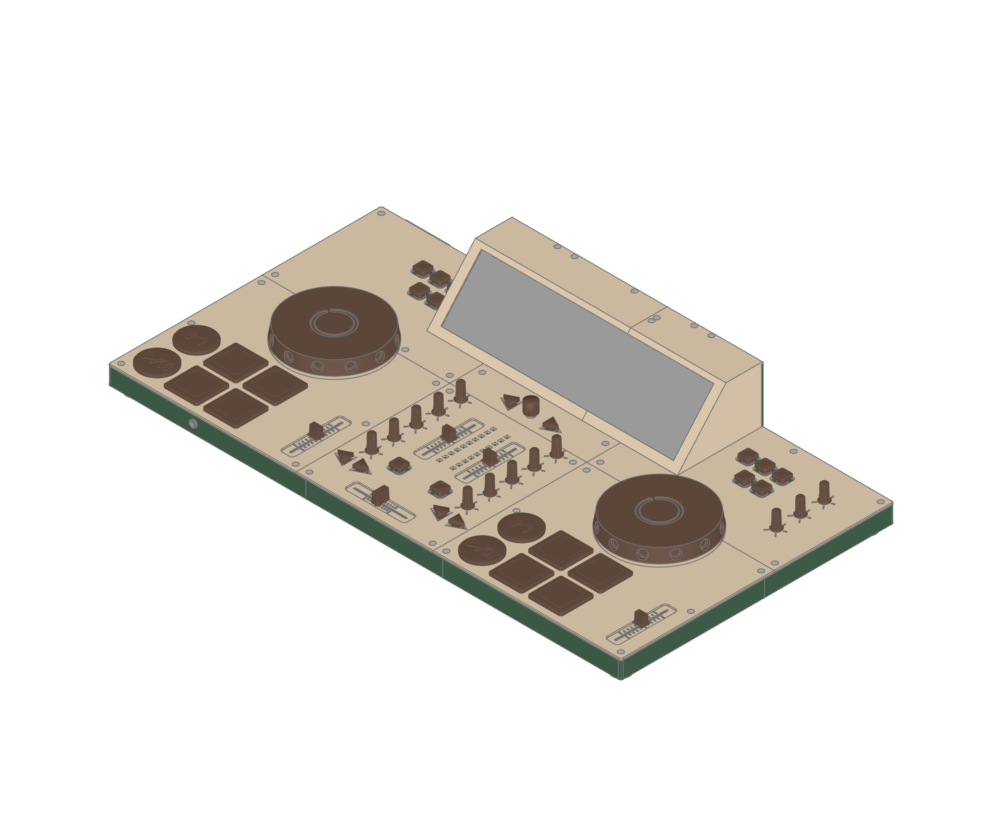

# beatbreaker

A DIY two-deck DJ/MIDI controller under development, combining physical controls and a 3D-printed enclosure with a Raspberry Pi running [Mixxx](https://mixxx.org/). An ESP32-S3 is intended to read the controls and drive the indicators.

*Actual CAD model view, not a photograph of an assembled controller. Prototype photos and demo video: **TBD**.*

*Special thanks to [DJC-DIY by mandiclab](https://github.com/mandiclab/djc-diy). Without it, beatbreaker would not exist.*

## Project status

**The project is a prototype in development.** REV_B is the sole current release, approved for an **unpowered mechanical trial**. It packages accepted B26-LAP-build123d11 geometry with integral jog-sensor seats and edge holders for ESP, both PCF8575 boards and the multiplexer. Physical fit, strength, electrical and thermal safety, and production readiness have not been established.

- The minimal package contains one complete drawing PDF, one standalone build123d Python source, one consolidated validation/BOM/environment/hash/handoff JSON,37STLs for169printed occurrences, one assembly STEP and two actual-model PNGs. STL coordinates are interpreted in **mm**.
- Reconstruction from the visible PDF construction/tables and independent source replay match all565represented occurrences. All37STL mesh checks and the565-leaf STEP round trip pass within their documented computational coverage.
- Original24sharp-bearing-reference pair-pose failures remain recorded. The separate source-bound SKF61806-2RS1 nominal interface checks pass; actual bearing seating, free rotation and substitute compatibility remain unverified.
- Controller holders are integral to C04 (ESP and U2 PCF8575) and C06 (U3 PCF8575 and multiplexer). Their physical retention remains unverified. DAC retention still needs design inputs; temporary hot glue is not a structural or electrical approval.
- The complete MIDI firmware, Mixxx mapping, electrical wiring and powered integration are **TBD**. The repository currently contains a separate serial-only input diagnostic.

Read the [REV_B consolidated validation and handoff](models/REV_B/beatbreaker_REV_B_validation.json) and [complete drawing](schematics/REV_B/beatbreaker_REV_B_drawing.pdf) for checks, limits and assembly definitions. REV_A and earlier releases are preserved history; their exceptions are not transferred to REV_B.

## Planned controller

| Function | Design |
| --- | --- |
| DJ software and host | Mixxx on Raspberry Pi 4 |
| Control electronics | ESP32-S3-DevKitC-1 reference; exact board/module variant to be confirmed |
| Decks and jogs | Two decks and two non-pressing jog assemblies with AS5048A magnetic rotary sensors |
| Analog controls | 13 rotary potentiometers and 5 faders |
| Buttons | 30 panel buttons; an additional NUDGE/SCRATCH mode button is **TBD**. Two PCF8575 modules are planned; final input allocation is unverified |
| Library browsing | One rotary encoder; its push contacts are unused |
| Indicators | Two 10-LED SK6812 RGBW chains for stereo master VU |
| Audio | Raspberry Pi DAC Pro, panel RCA and headphone interfaces; complete wiring and configuration **TBD** |
| Enclosure | FDM/FFF printed parts; PETG selected for enclosure parts |

These are design targets and selected components, not evidence of a working integrated controller. See [DESIGN.md](DESIGN.md) for the control definitions and qualification limits.

## Project files

| What | Location |
| --- | --- |
| REV_B unpowered mechanical trial | [Single validation, BOM, environment, hashes and handoff JSON](models/REV_B/beatbreaker_REV_B_validation.json) |
| Printable parts and quantities | [37STL definitions](models/REV_B/STL/) · `printed_parts` in the validation JSON |
| Assembly model | [STEP](models/REV_B/beatbreaker_REV_B_assembly.step) · [standalone build123d Python](models/REV_B/beatbreaker_REV_B.py) · [isometric view](models/REV_B/beatbreaker_REV_B_isometric_build123d-view.png) · [holder inspection view](models/REV_B/beatbreaker_REV_B_holders_build123d-view.png) |
| Current trial drawing | [Complete REV_B PDF](schematics/REV_B/beatbreaker_REV_B_drawing.pdf); no historical amendment or companion geometry-data files required |
| Working CAD sources and checks | [work/models/](work/models/) |
| Working drawings and studies | [work/schematics/](work/schematics/) |
| Electrical draft | E01 schematic: **TBD for publication**; not approved for complete wiring or energizing |
| ESP32-S3 diagnostic | [Bench firmware and instructions](firmware/bench_inputs/README.md) |
| Mixxx skin assets | [ShadeRemix](mixxx_skin/ShadeRemix/) |
| Decisions and open work | [Design](DESIGN.md) · [TODO](TODO.md) · [approvals](docs/APPROVALS.md) · [artifact register](docs/ARTIFACTS.md) |

`models/<release>/` and `schematics/<release>/` are reserved for releases; only `REV_B/` is currently published there. Put all new working files in `work/models/<subsystem>/<revision>/` or `work/schematics/<subsystem>/<revision>/`. Historical packages retained under `work/` keep their original approval scope and are not current releases.

Older records and frozen artifacts may contain publication-time paths. The pre-holder REV_B is preserved under `work/models/enclosure/REV_B-PRE-PCB11/`, with its drawing under `work/schematics/enclosure/REV_B-PRE-PCB11/`; its original `drawing.path` remains unchanged. Use the [artifact register](docs/ARTIFACTS.md) for historical lookup/staging; do not modify frozen package contents or hashes. The repository `.gitignore` excludes `work/`, `tmp/` and `docs/history/`; local working/history material may therefore be absent from a clone.

## Parts

The table is a design overview, **not an order-ready bill of materials**. Actual variants, stock, electrical compatibility, fasteners and installation details need verification. See [the detailed BOM boundary](DESIGN.md#8-bill-of-materials-boundary) and `printed_parts` in the [REV_B validation JSON](models/REV_B/beatbreaker_REV_B_validation.json) for printed definitions and quantities.

| Quantity | Part | Status / notes |
| ---: | --- | --- |
| 1 | Raspberry Pi 4 | Mixxx host |
| 1 | ESP32-S3-DevKitC-1 | Reference board; actual variant **TBD** |
| 1 | Raspberry Pi DAC Pro | Selected |
| 1 | Display | Identity **TBD** |
| 1 | Mean Well RS-25-5 power supply | Selected; complete power budget and safe installation **TBD** |
| 1 | Mains inlet / switch / fuse-holder assembly | Model, ratings and protection **TBD** |
| 1 each | Panel stereo RCA interface and headphone jack | Selected references; fit and wiring remain unverified |
| 13 | Rotary potentiometers | 10 kΩ; electrical taper **TBD** |
| 5 | Slide potentiometers | Electrical variant and pinout **TBD** |
| 30 | Panel switches | Exact electrical variant **TBD** |
| 1 | Browse encoder | Rotation only; push unused |
| 2 | AS5048A sensor modules | Actual breakout details **TBD** |
| 2 | PCF8575 modules | Addressing, pull-ups and actual interfaces **TBD** |
| 1 | CD74HC4067 analog multiplexer module | Selected mounting: flat underside, 2 mm PCB, no headers, top-only soldered wires; electrical integration **TBD** |
| 20 | SK6812 RGBW LEDs | Two 10-LED master VU chains; optics, power and brightness limits **TBD** |
| 1 | 74AHCT125 | Two channels planned for LED data level shifting |
| 4 | Jog bearings | SKF 61806-2RS1 reference; actual variant and fit **TBD** |
| 2 each | Integrated printed jog rotors and Ø8 ×4mm N35 diametric magnets | Actual print fit and magnetic operation **TBD** |
| TBD | NUDGE/SCRATCH mode button | Location, component, behavior and input allocation **TBD** |
| As needed | Screws, wiring, connectors and other hardware | Complete quantities and specifications **TBD** |

The REV_B validation JSON gives exact printed-part filenames, quantities and checksums. Nine inherited cap definitions retain their exact faceted meshes without recovered analytic feature histories. The PDF defines the complete represented geometry; incomplete vendor envelopes do not form a procurement-ready physical assembly.

## Software

- **Mixxx:** the intended DJ application. Version and controller mapping: **TBD**.
- **ESP32-S3 firmware:** [direct-input bench diagnostic](firmware/bench_inputs/README.md), written in Arduino C++. It reports one fader, one potentiometer, one button and one AS5048A sensor over serial. It does not send MIDI or implement the complete controller.
- **CAD:** REV_B uses one self-contained [build123d Python file](models/REV_B/beatbreaker_REV_B.py). The [validation JSON](models/REV_B/beatbreaker_REV_B_validation.json) records the environment, reproduction commands, source limitations and local standalone-viewer prerequisite.
- **Slicer and print settings:** [variant B](docs/PRINT_SETTINGS.md) is selected for the 4 mm PETG floor trial; alternatives A/C remain optional experiments. A Bambu P2S with a reported 256 × 256 mm bed and 0.4 mm nozzle is available; the project uses a conservative 250 × 250 × 250 mm part screen. Orientations, supports/removal, calibration and physical results remain unqualified.

## Getting started

1. **Review the scope.** Read the [REV_B validation and handoff](models/REV_B/beatbreaker_REV_B_validation.json) and [drawing](schematics/REV_B/beatbreaker_REV_B_drawing.pdf), especially the reference limits, print constraints and remaining safety work.
2. **Prepare a mechanical trial.** Use `printed_parts` in the REV_B JSON for STL filenames and quantities. Review the [selected floor recipe](docs/PRINT_SETTINGS.md), orientations, supports/removal and fit calibration before printing; the recipe is not qualified for every part. Jog and cap materials are not yet confirmed.
3. **Check actual parts and assembly.** Verify fader travel, jog operation, fasteners, joints, fit and strength against agreed criteria. Install controller boards into open lower shells before controls, jogs and other equipment. PCF/mux require flat finished undersides and no headers; qualify holder retention physically. DAC retention remains open. A complete illustrated assembly guide and assembly photos are **TBD**.
4. **Test electronics separately.** The [bench guide](firmware/bench_inputs/README.md) describes the limited diagnostic and its prerequisites. Confirm the actual board, sensor breakout and wiring before powering or uploading; uploading replaces existing board firmware.
5. **Complete electrical design before integration.** The full power/USB arrangement, mains protection, GPIO map, wiring and thermal checks are open. Do not energize the integrated controller or connect unverified power/USB combinations based on the trial model or draft schematic.
6. **Firmware and Mixxx setup:** **TBD**. A complete mapping, installation instructions and end-to-end controller test are not yet available.

## FAQ

**Can I print and build a working controller from this repository today?**  
The mechanical trial files are available, but the complete electronics, firmware, mapping and physical validation are unfinished. The trial is unpowered.

**Does it support other DJ software?**  
Mixxx is the design target. Compatibility and mappings for other software are **TBD**.

**Are the model files ready for production?**  
No. The approved scope is an unpowered mechanical trial. Print setup, physical fit, strength and electrical/thermal safety still require verification.

## Contributing and project links

- Open work and validation gates: [TODO.md](TODO.md).
- Contribution process, community, support links and build/demo videos: **TBD**.

## License

Software, hardware designs, documentation and media licenses: **TBD**. Do not assume that the licenses of the reference projects apply to this repository.
