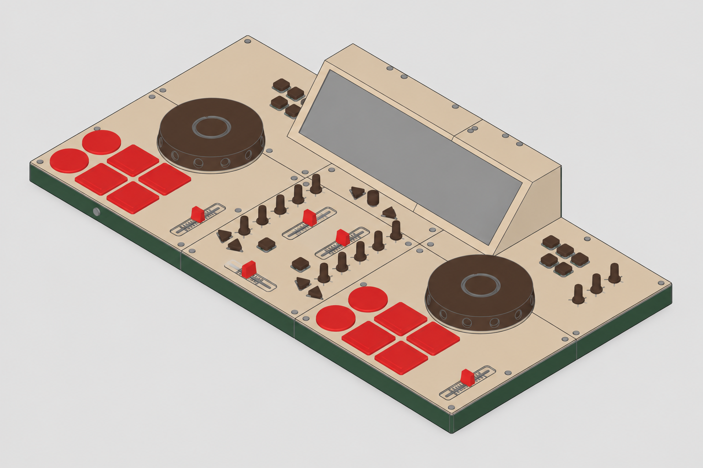

# beatbreaker

A DIY two-deck DJ/MIDI controller under development, combining physical controls and a 3D-printed enclosure with a Raspberry Pi running [Mixxx](https://mixxx.org/). An ESP32-S3 is intended to read the controls and drive the indicators.

*Actual CAD model view, not a photograph of an assembled controller. Prototype photos and demo video: **TBD**.*

## Project status

**The project is a prototype in development.** REV_A is the sole current release, approved for an **unpowered mechanical trial**. It retains the approved B26-build123d03 model and exports. Physical fit, strength, electrical and thermal safety, and production readiness have not been established.

- The trial package contains 36 distinct STL files representing 155 printed occurrences, an assembly STEP, model sources and actual-model views. STL coordinates are interpreted in **mm**.
- Two P01 rotors failed the strict default STEP volume comparison by approximately 0.6410915 mm³ each. The engineer accepted a specifically bounded numerical exception; this is not a strict pass.
- C03/C05 reverse Boolean comparisons during documentation reconstruction were invalid; the engineer accepted a separate bounded unpowered-trial exception. Strict geometric equivalence remains unresolved.
- Permanent PCB mounts and DAC retention need further dimensions and design. Temporary hot glue is a test proposal, not a structural or electrical approval.
- The complete MIDI firmware, Mixxx mapping, electrical wiring and powered integration are **TBD**. The repository currently contains a separate serial-only input diagnostic.

Read the [REV_A trial handoff](models/release/enclosure/REV_A/REV_A_handoff.md) for the export checks, exceptions and remaining work. Do not use the older B26-build123d02 enclosure STLs: they remain on hold.

## Planned controller

| Function | Design |
| --- | --- |
| DJ software and host | Mixxx on Raspberry Pi 4 |
| Control electronics | ESP32-S3-DevKitC-1 reference; exact board/module variant to be confirmed |
| Decks and jogs | Two decks and two non-pressing jog assemblies with AS5048A magnetic rotary sensors |
| Analog controls | 13 rotary potentiometers and 5 faders |
| Buttons | 30 panel buttons; an additional NUDGE/SCRATCH mode button is **TBD**. Two PCF8575 modules are planned; final input allocation is unverified |
| Library browsing | One rotary encoder; its push contacts are unused |
| Indicators | Two 10-LED SK6812 RGBW chains for stereo master VU |
| Audio | Raspberry Pi DAC Pro, panel RCA and headphone interfaces; complete wiring and configuration **TBD** |
| Enclosure | FDM/FFF printed parts; PETG selected for enclosure parts |

These are design targets and selected components, not evidence of a working integrated controller. See [DESIGN.md](DESIGN.md) for the control definitions and qualification limits.

## Project files

| What | Location |
| --- | --- |
| REV_A unpowered mechanical trial | [Release package and handoff](models/release/enclosure/REV_A/REV_A_handoff.md) |
| Printable parts and quantities | [STL files and manifest](models/release/enclosure/REV_A/STL/B26-build123d03_STL_manifest.json) |
| Assembly model | [STEP](models/release/enclosure/REV_A/STEP/B26-build123d03-trial-assembly.step) · [build123d source package](models/release/enclosure/REV_A/SOURCE/) · [model views](models/release/enclosure/REV_A/VIEWS/) |
| Current trial drawings | [REV_A consolidated PDF and companion data](schematics/release/enclosure/REV_A/) |
| Electrical draft | E01 schematic: **TBD for publication**; not approved for complete wiring or energizing |
| ESP32-S3 diagnostic | [Bench firmware and instructions](firmware/bench_inputs/README.md) |
| Mixxx skin assets | [ShadeRemix](mixxx_skin/ShadeRemix/) |
| Decisions and open work | [Design](DESIGN.md) · [TODO](TODO.md) · [approvals](docs/APPROVALS.md) · [artifact register](docs/ARTIFACTS.md) |

Working revisions in `models/work/` and `schematics/work/`, as well as `docs/history/`, are ignored by Git and may be absent from a clone. Older records may use pre-migration paths or describe earlier releases as current. Use the [artifact register](docs/ARTIFACTS.md) for historical context; do not modify frozen artifacts to repair their paths.

## Parts

The table is a design overview, **not an order-ready bill of materials**. Actual variants, stock, electrical compatibility, fasteners and installation details need verification. See [the detailed BOM boundary](DESIGN.md#8-bill-of-materials-boundary) and the [REV_A STL manifest](models/release/enclosure/REV_A/STL/B26-build123d03_STL_manifest.json) for definitions and quantities.

| Quantity | Part | Status / notes |
| ---: | --- | --- |
| 1 | Raspberry Pi 4 | Mixxx host |
| 1 | ESP32-S3-DevKitC-1 | Reference board; actual variant **TBD** |
| 1 | Raspberry Pi DAC Pro | Selected |
| 1 | Display | Identity **TBD** |
| 1 | Mean Well RS-25-5 power supply | Selected; complete power budget and safe installation **TBD** |
| 1 | Mains inlet / switch / fuse-holder assembly | Model, ratings and protection **TBD** |
| 1 each | Panel stereo RCA interface and headphone jack | Selected references; fit and wiring remain unverified |
| 13 | Rotary potentiometers | 10 kΩ; electrical taper **TBD** |
| 5 | Slide potentiometers | Electrical variant and pinout **TBD** |
| 30 | Panel switches | Exact electrical variant **TBD** |
| 1 | Browse encoder | Rotation only; push unused |
| 2 | AS5048A sensor modules | Actual breakout details **TBD** |
| 2 | PCF8575 modules | Addressing, pull-ups and actual interfaces **TBD** |
| 1 | CD74HC4067 analog multiplexer module | Installed pin height and electrical integration **TBD** |
| 20 | SK6812 RGBW LEDs | Two 10-LED master VU chains; optics, power and brightness limits **TBD** |
| 1 | 74AHCT125 | Two channels planned for LED data level shifting |
| 4 | Jog bearings | SKF 61806-2RS1 reference; actual variant and fit **TBD** |
| 2 each | Jog shafts and Ø8 × 4 mm N35 diametric magnets | Machining, fit and magnetic operation **TBD** |
| TBD | NUDGE/SCRATCH mode button | Location, component, behavior and input allocation **TBD** |
| As needed | Screws, wiring, connectors and other hardware | Complete quantities and specifications **TBD** |

The REV_A STL manifest gives the exact filenames, quantities and checksums of the printed trial parts. The trial package includes nine inherited mesh-only cap definitions without editable feature histories; it is not a complete procurement or assembly guide.

## Software

- **Mixxx:** the intended DJ application. Version and controller mapping: **TBD**.
- **ESP32-S3 firmware:** [direct-input bench diagnostic](firmware/bench_inputs/README.md), written in Arduino C++. It reports one fader, one potentiometer, one button and one AS5048A sensor over serial. It does not send MIDI or implement the complete controller.
- **CAD:** the B26 trial source uses build123d. The [REV_A handoff](models/release/enclosure/REV_A/REV_A_handoff.md) records the environment, source limitations and viewer instructions; older revisions use other CAD workflows.
- **Slicer and print settings:** **TBD**. A Bambu P2S with a reported 256 × 256 mm bed and 0.4 mm nozzle is available; the project uses a conservative 250 × 250 × 250 mm part screen. This is not a validated print orientation or usable-bed guarantee.

## Getting started

1. **Review the scope.** Read the [REV_A handoff](models/release/enclosure/REV_A/REV_A_handoff.md), especially its exceptions, print limitations and remaining safety work.
2. **Prepare a mechanical trial.** Use the REV_A STL manifest for filenames and quantities. Determine orientations, supports, print settings and fit calibration before printing; these remain **TBD**. Jog and cap materials are not yet confirmed.
3. **Check actual parts and assembly.** Verify fader travel, jog operation, fasteners, joints, fit and strength against agreed criteria. Permanent board and DAC retention remain open. A complete illustrated assembly guide and assembly photos are **TBD**.
4. **Test electronics separately.** The [bench guide](firmware/bench_inputs/README.md) describes the limited diagnostic and its prerequisites. Confirm the actual board, sensor breakout and wiring before powering or uploading; uploading replaces existing board firmware.
5. **Complete electrical design before integration.** The full power/USB arrangement, mains protection, GPIO map, wiring and thermal checks are open. Do not energize the integrated controller or connect unverified power/USB combinations based on the trial model or draft schematic.
6. **Firmware and Mixxx setup:** **TBD**. A complete mapping, installation instructions and end-to-end controller test are not yet available.

## FAQ

**Can I print and build a working controller from this repository today?**  
The mechanical trial files are available, but the complete electronics, firmware, mapping and physical validation are unfinished. The trial is unpowered.

**Does it support other DJ software?**  
Mixxx is the design target. Compatibility and mappings for other software are **TBD**.

**Are the model files ready for production?**  
No. The approved scope is an unpowered mechanical trial. Print setup, physical fit, strength and electrical/thermal safety still require verification.

## Contributing and project links

- Open work and validation gates: [TODO.md](TODO.md).
- Contribution process, community, support links and build/demo videos: **TBD**.
- README structure informed by [DJC-DIY](https://github.com/mandiclab/djc-diy) and [DIY DJ Controller](https://github.com/jueta/DIY_DJ_Controller).

## License

Software, hardware designs, documentation and media licenses: **TBD**. Do not assume that the licenses of the reference projects apply to this repository.
